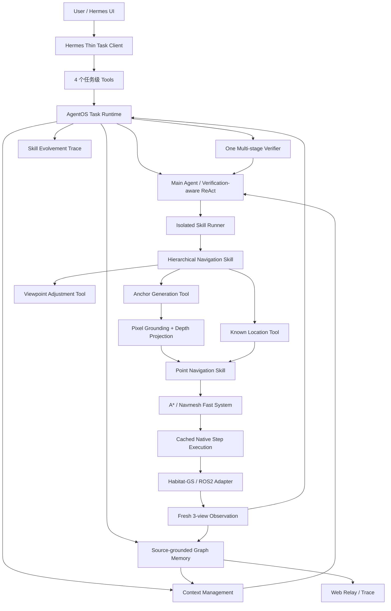
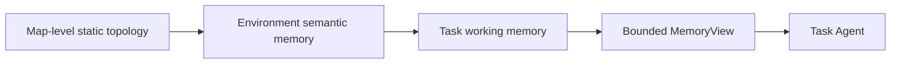

# Anchor Agent 开发报告

> 文档类型：持续更新的工程开发报告（Living Document）
> 首次建档：2026-08-18
> 最近更新：2026-08-27
> 当前开发分支：`experiment/agentos-replica`
> 当前代码状态：按 ABot-AgentOS 公开报告复刻的独立 Main Agent / Skill Runner / Verifier Harness
> 稳定测试基线：`VLN-agentos-test-version-0827-stable-semantic-map-object-search`
> 兼容回滚基线：`release/cyhy-agentos-version1` / `cyhy-agentos-version1` / `90d3339`
> 最近完整验证：271 项测试通过；白冰箱语义地图寻物任务在 Habitat 完成
> 报告更新时服务状态：AgentOS + Habitat `8765`、Web Relay `5916`、Hermes 已启动

本报告记录 CEE-AgentOS 中 Anchor Agent 从独立 Agent Harness、Habitat 接入、OmniNav 原子能力、
Minimal VLN，到当前分层锚点导航、可迁移 Agent Memory、语义拓扑和静态骨干拓扑原型的完整演进。
报告不仅记录最终方案，也保留失败实验、错误现象、回滚原因、性能数据和过程图。

- [完整开发时间线](development_history.md)
- [过程图与错误截图索引](process_image_index.md)
- [论文 Method 草稿](../docs/method_portable_memory_reasoning_zh.md)
- [当前分层导航协议](../docs/hierarchical_navigation.md)
- [ABot-N0/N1 + AgentOS 架构合同](../docs/abot_n0_n1_agentos_architecture.md)
- [实验与指标附件](evidence/benchmarks/)
- [2026-08-18 详细开发记录](evidence/daily_development_20260818.md)
- [2026-08-19 详细开发记录](evidence/daily_development_20260819.md)
- [2026-08-20 ABot 差异、Verifier 与 Omni Skill 审计](evidence/abot_gap_verifier_omni_audit_20260820.md)
- [2026-08-20 ABot-AgentOS 严格复刻与 Habitat 验证](evidence/agentos_replica_validation_20260820.md)
- [2026-08-27 语义地图寻物稳定版本详细记录](evidence/daily_development_20260827.md)
- [Office / White Fridge Node-first 审计](evidence/node_first_office_fridge_audit_20260818.md)
- [原始阶段笔记快照](evidence/live_notes_snapshot_20260818.md)

## 1. 项目定位

系统 Harness 仍以 **ABot-AgentOS** 的 Main Agent、Skill Runner、Verifier、Context/Memory 和 Trace 分层为
主体；导航认知与执行接口进一步参考 **ABot-N0/N1**。N0 提供 Planner、Actor、Episodic Memory、四层
Topo-Memory 和 Self-Reflector 的功能角色，N1 提供任务专用 CoT、双像素目标以及低频 Slow/高频 Fast 的接口。
当前不复制训练体系和模型权重，Qwen 作为 Slow System，A* 与单步控制器作为功能等价 Fast System。

系统遵循一条核心原则：

> 语言负责语义推理，结构化协议负责执行。

大模型不直接输出速度、不逐帧控制机器人，也不能把局部导航模型的 STOP 当成全局任务完成。
它在宏观决策点选择带成功条件的 Skill；局部路径规划和控制在 Skill 内闭环执行。

## 2. 目标与非目标

### 2.1 目标

1. 用户给出长程自然语言任务后，Agent 能拆解为一系列当前可执行的局部子任务。
2. 当前优先形式为 `Navigate towards <当前可见锚点或可通行区域>`。
3. 每个宏任务完成后，联合全局任务、最近轨迹关键帧、当前三视图、上一 Slow 决策和 Topo-Memory 复盘。
4. 看不到直接目标时，沿可通行走廊、开放门洞或更宽阔的未探索区域主动探索。
5. 发现重复、受阻或错误分支时，能够返回历史观测位置或语义拓扑节点并恢复朝向。
6. Habitat-GS 与 ROS2 机器狗共享 Agent、Memory 和 Skill 协议，仅替换 Embodiment Adapter。
7. 视觉历史和长期记忆持久保存，但进入 LLM 的内容始终有界。

### 2.2 非目标

1. 不迁移 CEE-Nav 的旧状态机和大量兼容逻辑。
2. 不让 Hermes 或任务级 LLM 接管逐帧控制。
3. 不要求局部 STOP 直接完成全局任务。
4. 不把 Habitat 真值写死为 Agent Memory 的唯一数据来源。
5. 不复刻 ABot 的训练数据、专有权重或学习型动作专家，也不立即接入全部实机安全机制。

## 3. 当前总体架构



### 3.1 Agent 可见的任务级 Tools

严格分支中 Hermes 只暴露四个 AgentOS 任务边界，不再参与内部 Planner/Actor/Skill 编排：

| Tool | 职责 | 是否移动机器人 |
| --- | --- | --- |
| `cee_navigation_status` | 查询 AgentOS/本体健康和 Harness 配置 | 否 |
| `cee_start_agent_task` | 向服务端 Main Agent 提交一次全局任务 | 间接 |
| `cee_navigation_task_status` | 查询计划、Skill Runner、Verifier 和终态 | 否 |
| `cee_cancel_agent_task` | 取消当前任务并触发安全停止 | 是 |

### 3.2 Runtime 内部 Skills

`HierarchicalNavigationSkill` 是当前严格分支注册给 Main Agent 的宏 Skill。以下能力作为其 Skill Runner
内部 Tools 存在，不直接暴露给 Hermes：

| Skill | 输入 | 输出 |
| --- | --- | --- |
| `AnchorGenerationSkill` | 当前三视图、可见锚点、视图方向 | 像素坐标、置信度、标注图 |
| `PixelToPointSkill` | 像素、同步深度、相机参数 | 相机/机器人/世界坐标点 |
| `PathPlanningSkill` | 世界坐标点 | Navmesh 吸附点和最短路径 |
| `PointNavigationSkill` | 可导航点或历史地点 | 规划、单步执行、轨迹关键帧 |
| `ViewpointAdjustmentSkill` | 左转、右转、前移或后退一次 | 新位姿和同步三视图 |
| `KnownLocationNavigation` | `location-NNN` | 返回历史观测位置并恢复记录朝向 |

**Tool 与 Skill 的区别**：Tool 是 Agent 可调用的语言模型边界；Skill 是 Runtime 内部可组合、可验证、
可替换的原子执行能力。多个 Tool 可以复用同一个 Skill，例如可见锚点和历史地点回退都复用
`PointNavigationSkill`。

## 4. 当前宏观闭环

```text
用户指令
  -> begin：当前三视图 + Episodic Memory + 四层 Topo-Memory
  -> N0 Planner：Approaching / Reaching / Interaction 类型化计划
  -> N1 Slow：任务专用 CoT + 语义目标
  -> 双像素接口：bbox target pixel + A* affordance pixel
  -> Actor：选择一个宏观 Skill
  -> Fast：缓存 A* 路径并执行原生单步动作，不调用 LLM
  -> 保存最多 4 张覆盖完整子任务轨迹的关键帧
  -> 自动获取新的 LEFT / FRONT / RIGHT
  -> Self-Reflector：完成下一子任务、继续或重规划
  -> Finish Verifier：独立授权全局 DONE / FAILED
```

每个 `advance_navigation` 决策显式包含：

- 初始或被要求重规划时的 `AgenticPlannerOutput`；
- 当前活动 `navigation_task_type`；
- 与任务类型严格匹配的短 CoT，或 `cot=null`；
- 上一活动子任务的 `self_reflection`；
- 一个 Actor 动作：视觉锚点、历史/骨干地点或视角调整；
- 当前观测的有界语义摘要。

旧候选评分、route hypothesis 和 assessment 仅在兼容层内部生成，不再暴露给模型。Runtime 只接受最新
`observation_id`，并验证 Plan、Task Type、CoT、Self-Reflection 与动作一致性，避免自由文本直接变成运动命令。

## 5. 锚点导航链路

### 5.1 锚点选择原则

当前策略优先级为：

1. 当前视野内与全局目标直接相关的物体、门洞或空间边界；
2. 若目标不可见，选择明确可通行的走廊地面、开放门洞或通向更宽阔未探索空间的入口；
3. 当没有可靠通路，或一次有界转向能消除歧义时，调整视角；
4. 当上一分支无进展、受阻或假设被否定时，返回最近语义拓扑节点再换分支。

允许为了寻找更安全、更相关或信息增益更高的锚点进行一次有目的视角调整；不鼓励无目的连续旋转、
振荡或碰撞后的重复动作。

### 5.2 像素锚点与置信度安全门

Qwen 视觉模型同时读取独立标记的 LEFT/FRONT/RIGHT 三张图，选择目标所属 View，并返回该单图内固定
`0..1000` 坐标系的目标 bbox。Runtime 将 bbox 映射到 `640 x 480`，在底边中心下方生成确定性地面
接触像素，再由同步深度反投影为世界坐标。Web Relay 使用黄色框显示目标 bbox、红色十字显示实际导航点。

该合同替代了早期“模型自行声明 pixels 或 normalized_1000、Runtime 越界后猜测”的不稳定做法，避免
三联图全局坐标被误当成单路局部坐标。

当前锚点置信度阈值为 `0.80`：

- `confidence >= 0.80`：进入深度投影、路径规划和执行；
- `confidence < 0.80`：像素被 Runtime 拒绝，不进入控制；
- 恢复方式由 Agent 预先选择为一次视角调整或返回上一历史节点；
- 如果不存在上一节点，Runtime 确定性降级为视角调整。


| 旧坐标空间误判 | 当前 bbox + 地面点 |
| --- | --- |
|  |  |

### 5.3 路径规划和执行

最初的分层版本使用 Pure Pursuit 跟踪 A*/Navmesh 路径。实测中出现过看似“瞬移”、转向与仿真动作不一致、
以及无法稳定形成可复盘关键帧的问题。当前 Habitat 版本保留 Navmesh 最短路径规划，执行改为 Habitat
greedy geodesic follower，每个控制周期只发出一个原生 `turn_left`、`turn_right` 或 `move_forward`。
任务级 LLM 不进入控制循环。

`max_control_steps=64` 现在是 Skill 内部安全分块，不再是 Agent 推理边界。预算耗尽但路径健康时，Runtime
自动观测、刷新同一目标路径并继续；只有到达、持续卡住、路径失效、取消/超时或高置信语义事件才回到 Agent。
一次 B003 实测跨 64 + 17 两个内部块完成 81 个动作，没有在第 64 步调用 Agent。

一次真实链路验证：地理路径约 2.83 m、2 个路径点、12 个原生动作、实际移动约 2.40 m、0 碰撞，
在 0.5 m 容差内剩余约 0.43 m；关键帧覆盖动作 0/4/8/12。

| 起点 | 过程 1 | 过程 2 | 终点 |
| --- | --- | --- | --- |
|  |  |  |  |

## 6. Agent Memory

### 6.1 设计动机

早期系统把完整 `exploration_memory`、场景描述和历史图片反复塞入 Hermes 对话。任务越长，工具结果越大，
导致输入 token 线性增长、压缩延迟、错误修复循环和任务提前退出。现在采用：

> 服务端持久保存完整证据，LLM 每轮只接收有界检索视图。

### 6.2 三种记忆范围



| 范围 | 内容 | 生命周期 |
| --- | --- | --- |
| 地图级静态拓扑 | Navmesh/OccupancyGrid 骨架、固定节点、几何连接 | 按 `map_id + geometry hash` 缓存 |
| 环境级语义记忆 | 地点语义、可见目标、访问次数、通行边 | 可跨任务持久化，当前默认按任务检索隔离 |
| 任务工作记忆 | 全局任务、活动计划、上一 Slow 决策、Self-Reflection、上一动作 | 新任务重新建立 |

### 6.3 地点与视觉证据

每个地点或轨迹关键帧记录：

- `location_id`、`map_id`、`episode_id`、`task_id`；
- `pose`、`yaw`、坐标系、来源、置信度和时间戳；
- 可再次调用的 `navigation_point_xyz_m`；
- 场景摘要、语义标签和 LEFT/FRONT/RIGHT 方向语义；
- 原始图片文件引用，而不是 SQLite 中的图像字节。

`location-025` 表示“机器人看到 sofa 时所在的历史观察位置”，不是 sofa 自身的三维坐标。返回该地点后，
系统恢复当时朝向，再由当前观测生成朝向 sofa 或门口的新锚点。

### 6.4 固定空间参考

当前实验版不再让首帧三视图永久驻留模型上下文。原始任务保存在 Agentic Plan；冻结语义骨干、当前 pose 和
四层 Topo-Memory 共同构成稳定空间参考。首帧仍可作为普通任务证据存档，但下一视觉包到达后退出活跃窗口。
这样既避免跨任务保留错误首帧，也消除了每轮固定携带三张旧图的成本。

### 6.5 关键帧视觉记忆

每次完整移动子任务保存最多 4 张均匀覆盖轨迹的前视关键帧。当前上下文自动保留：

1. 最近一次移动宏任务的最多 4 张前视关键帧；
2. 最新同步三视图和结构化 Slow/Fast 结果；
3. 原始任务、活动计划、上一 CoT/像素决策和四层 Topo-Memory；
4. 按需召回的最多 4 张旧关键帧，下一次导航结果到达后退出活跃窗口。

更早图片不会继续累加，但服务器端归档不删除。Agent 可以按 `task_overview`、`latest_subtask`、地点 ID 或
语义关键词召回。

### 6.6 有界结构化检索

每轮 `MemoryView` 包含当前地点和最多 5 个相关地点，并携带路线假设、回退地点、否定分支、路网节点数和
视觉归档统计。地点排序当前使用可复现的词项重叠、新近度和拓扑节点加权，尚未使用向量检索。

## 7. 稀疏路网与语义拓扑

### 7.1 从密集路点到决策节点

曾经按 0.75 m 对控制轨迹去重生成路网。它能形成通行图，但普通走廊停点过多，既增加模型负担，也不符合
人类通常只记住起点、岔路口和开阔区域的导航习惯。

当前将两类对象分开：

- **视觉证据位置**：最多 4 张关键帧，各自有 pose/yaw，可召回和回访；
- **语义拓扑节点**：只保留全局起点、真实多分支岔路口和空旷区域中心。

普通走廊停点和密集控制路点不进入可视化拓扑。Agent 通过三视图标记 `junction` 或
`open_space_center`；Runtime 稳定其位置和属性，实际通行形成 `traversed_to` 边。


### 7.2 探索意图和模型回退决策

动作意图分为：

- `goal_pursuit`：沿直接目标证据前进；
- `explore_route`：目标不可见时沿可通行空间探索；
- `backtrack`：返回历史目标证据点或拓扑决策点。

如果上一轮为 `no_progress`、`blocked` 或 `hypothesis_rejected`，Qwen Self-Reflector 与 Actor 根据最新
三视图、上一轨迹和 Topo-Memory 选择历史回访、90 度视角调整、另一锚点或节点切换。Runtime 只验证 ID、
拓扑连通和路径安全，不用确定性文本规则改写模型的语义恢复动作。

### 7.3 静态骨干拓扑在线加载

2026-08-18 完成了一个离线原型：从 Habitat 完整 Navmesh 提取 medial skeleton，再聚类稳定岔路和局部
净空极大值。`1st_floor_exh` 原型包含 1,891 个骨架像素、3 个岔路节点和 5 个开阔区域中心。

该原型已接入运行时：地图按 `map_id + geometry revision + extraction parameters` 缓存；服务启动时命中
缓存则直接载入 8 个固定骨干节点和 8 条边，未命中才提取。拓扑和语义 JSON 在服务生命周期内冻结，任务
reset 只重建任务记忆，不新增起点节点、不更新节点语义、不重新提图。

第一版在线建边曾在同一自由空间分量内使用欧氏 MST，导致空间上接近但隔墙的 B002-B003 被直接连接。
当前 `sparse-backbone-v3` 在 medial skeleton 上执行多源最短路，只连接 skeleton Voronoi 区域实际相接的
节点，并保存自由空间内的简化折线路径。Web Relay 沿折线绘制，Hermes 上下文删除折线几何。


| 修复前：欧氏 MST | 修复后：Skeleton 邻接 |
| --- | --- |
|  |  |

### 7.4 可编辑语义节点与四层 Topo-Memory

节点语义存放在 `runtime/semantic_maps/<map_id>.json`，描述场所类型、功能、物体、地标、空间特征、任务
affordance 和别名，可由人直接修订，重启服务后载入。Runtime 将其投影成 Block、Road、Function、Object/POI
四层 Topo-Memory，Planner 在看到当前观测后联合读取这些层，选择类型化、保持指令顺序的子任务与区域目标。

当前实验版以连续视觉锚点为主要局部执行方式，Topo-Memory 提供场所消歧、Road 连通约束、区域到达判定和
跨区恢复。Planner 选定目标区域后，锚点链必须沿有序相邻节点逐段推进；只有全部前序边完成才进入目标区域
搜索。历史 `location_id` 仍只代表视觉证据位置和朝向恢复点，不与稳定 B 节点混用。


## 8. 相机与 Web Relay

三路相机参数已从配置和实测共同确认：

| 视图 | 分辨率 | HFOV | 有效 VFOV | 相对 yaw |
| --- | --- | --- | --- | --- |
| LEFT | 640 x 480 | 120° | 约 90.03° | +90° |
| FRONT | 640 x 480 | 120° | 约 90.03° | 0° |
| RIGHT | 640 x 480 | 120° | 约 90.03° | -90° |

Web Relay 是只读可视化，不承载任务指令输入。布局经过多轮迭代：三视图固定在首行，Topdown 和锚点图
位于第二行并尽量填充空间，右侧展示任务、阶段、Skill、Controller、动作、位姿、观测 ID、记忆和路网状态。
根据需求保留大图显示，但没有加入点击全屏行为。


完整布局迭代见[过程图索引](process_image_index.md#5-web-relay-布局迭代)。

## 9. 模型、延迟与上下文

### 9.1 Provider

- Qwen：OpenAI-compatible API，当前分层 Agent 与锚点视觉模型均使用 Qwen3.6-VL-35B。
- Gemini：已实现 Gemini API Provider 和 Flash 配置切换；真实测试遇到免费层每分钟 5 次请求限制，
  Hermes 一轮通常产生 3-10 次调用，因此出现 HTTP 429 `RESOURCE_EXHAUSTED`，未作为稳定后端。


### 9.2 用户可感知延迟

基于同一起点和同一卧室找床任务的历史测量：

| 指标 | 结果 |
| --- | ---: |
| 收到指令到第一次观测完成 | 约 2.956 s |
| 收到指令到第一个可执行子任务 | 约 3.960 s |
| 旧流程子任务切换平均延迟 | 约 4.166 s |
| 自动后观测后平均切换延迟 | 约 3.333 s |
| 自动观测与结果打包 | 平均约 0.310 s |
| 任务级 Agent 推理 | 13 次共 14.500 s，平均约 1.115 s |
| 锚点推理 | 5 次约 4.115 s，平均约 0.823 s |

以上统计排除了 Habitat 单步执行时间。一次旧版 Hermes 上下文压缩耗时约 25 s，并把粗略上下文从
71,048 降到 22,919 tokens；自动后观测减少了一次仅为取新观测而发生的 Agent 调用。

### 9.3 上下文膨胀的演进

1. 早期每轮返回锚点图、4 张关键帧、3 张新视图，历史工具消息累计全部图片。
2. Scene Memory v1 又重复完整场景索引，19 次导航理论上可在历史中形成大量图片和文本。
3. 第一版图片裁剪只在 LLM 请求前生效，但持久消息仍保存 Base64，Hermes 压缩估算发生在裁剪前，产生误压缩。
4. 当前工具结果持久化 `cee-local-image:` 文件引用，只在最新请求发出前按需注入图片。
5. 当前 provider 请求使用固定导航消息窗口，禁用不适配该窗口的自动 Hermes 压缩。

40 轮回归中，5 轮和 40 轮的模型请求都只包含 3 条消息和有界图片，序列化大小相差不足 100 字符。旧实验曾
固定保留首帧而形成最多 11 张图；当前版本移除首帧常驻后，正常决策窗口只自动携带上一宏任务最多 4 张前视
关键帧和当前 3 张视图，更早图片仅按需召回。

2026-08-18 对一条完整 bedroom 任务再次审计：最终调用为 26,248 input tokens，11 张图约占 3,369
tokens（12.8%）；更大的来源是重复 MemoryView、route graph 和完整结果 JSON。任务总耗时 71.80 s，
其中 Habitat 控制 34.66 s、10 次 Agent 调用 31.50 s。详细拆分见开发时间线阶段 24。

### 9.4 Token 基准

同一任务的有界视觉上下文实验：

- 旧成功基线：25 次调用，累计输入 589,771 tokens，平均 23,590.84，峰值 49,972；
- 有界图片实验：20 次调用、14 次成功导航，累计输入 239,515，平均 11,975.75，峰值 24,470；
- 同为前 20 次调用时，输入量下降约 35.81%；
- 在 14 次导航进度点下降约 15.29%；
- 新实验未完成任务，因此不能把总量直接当作成功率等价对比。

原始数据位于 [`evidence/benchmarks`](evidence/benchmarks/)。

## 10. 关键失败与设计修正

### 10.1 服务未启动

Hermes 曾在 Habitat/AgentOS 服务未监听时反复调用导航工具，出现 `Connection refused`。这说明启动脚本、
服务健康检查和 Agent 工具可用性必须解耦，不能让模型自行猜测如何启动后端。


### 10.2 工具循环和 observation_id 混乱

早期低层工具直接暴露时，模型会猜测 `observation_id=default/main/obs1`，重复 observe、ground、navigate，
甚至进入长循环。当前四工具接口和 Runtime 托管最新 observation ID，正是由这一失败推动的。


### 10.3 普通文本导致任务提前退出

一次任务中，Qwen 文字上说“继续向前导航”，但没有生成工具调用。API `finish_reason=stop` 只是本轮文本生成结束，
并不是机器人 STOP；Hermes 却结束了该聊天轮。曾实验强制 `tool_choice=required` 和 active-task stop guard，
但与 deferred tool search 冲突，造成 unknown tool 循环，最终回滚至 `2ce1efa`。


### 10.4 `finish_reason=length` 与 Unknown Tool

`finish_reason=length` 表示单次模型输出超过 `max_tokens`，不是输入上下文已满。把上限从 256 提到 384 后仍出现，
因为模型可能在形成结构化工具调用前耗尽输出；再配合强制工具和 deferred tool search，产生
`Unknown tool 'navigate_to_visible_anchor'`。当前结构化高层决策上限为 768 tokens，额外 thinking 关闭，
并通过规范化器减少修复调用。

| Unknown Tool | 输出截断与推理文本消失 |
| --- | --- |
|  |  |

### 10.5 Scene Memory v1 反而增加探索

Scene Memory v1 能识别重访：21 次访问中得到 10 个唯一场景，6 个场景重访、11 次为重复访问；但完整场景描述
和累计索引干扰了锚点决策，并加快上下文膨胀。该任务 19 次成功导航、2 次路径失败后因上下文容量退出，
普通子任务切换平均 4.741 s，差于稳定基线 3.333 s。该方案保留为历史实验，没有进入当前 Runtime。

### 10.6 锚点视觉模型非 JSON 输出

Qwen 锚点模型偶发返回无法解析的内容，产生 HTTP 400 `Qwen anchor grounding did not return a JSON object`。
该故障与 Habitat 健康状态无关。当前仍需要补充原始模型响应的安全日志、有限重试和降级策略。


### 10.7 历史地点 ID 格式

模型知道 sofa 出现在 `location-025`，但曾把完整描述写入 `location_id`，违反
`^location-[0-9]{3,}$`。当前 normalizer 会从显式字段、动作 target 或候选 target 中提取首个合法 ID，
同时保留人类可读 target。该修复提交为 `4852c17`。


### 10.8 RIGHT 视图 bbox 坐标空间误判

Qwen 正确识别 RIGHT 视图中的白色人形机器人，但返回越界的 `x=715, y=500` 并声明为 pixels。旧代码
静默改按局部 `0..1000` 解释，最终把锚点画到冰箱 `(457,240)`。当前使用三张独立图和固定局部归一化
bbox 合同，同帧得到 bbox `[240,220,265,268]` 与脚前地面点 `(252,278)`。


### 10.9 Node-first 首轮只检索地点

任务 `go to office to find a white fridge` 中，B001 以 0.992 命中 office；B002 已保存 refrigerator、
tall white refrigerator 和对应 affordance，并与 B001 拓扑邻接。旧首轮只查询 `destination_query=office`，
机器人先到 B001 并执行两次局部探索，之后 Agent 才使用已有 B002 信息。该问题随后通过关系感知节点排序解决，
并在 `c3e49ad` 中进一步由 Planner 直接读取四层 Topo-Memory，不再依赖独立公开 semantic search 工具。

### 10.10 欧氏 MST 生成跨墙假边

旧算法把欧氏距离 6.956 m、但 skeleton 路径 21.383 m 的 B002-B003 直接连边，在 Web 中表现为
`location-004 -> location-005` 穿墙直线。当前使用 skeleton 多源最短路邻接，假边已删除；弯曲合法边按
`path_world_xy_m` 折线显示。新版缓存键为 `63271126e56dc000b09a`。

## 11. 版本与回滚

### 11.1 当前有效代码线

```text
2ce1efa  stable baseline
  -> active viewpoint / semantic map / known location
  -> portable Agent Memory + structured Task Reasoner
  -> bounded provider request
  -> global visual anchor + sparse route
  -> route graph visualization
  -> confidence gate + bounded visual recall
  -> traversable exploration + semantic topology
  -> 4852c17 known-location ID fix
  -> online cached backbone + editable node semantics
  -> node-first semantic route + 5 m local anchor scope
  -> atomic node/point execution + bbox grounding fix
  -> skeleton-constrained topology edges + Web polylines
  -> 5ebae16 frozen semantic backbone stable baseline
  -> 574763e topology-guided visual anchor chain
  -> 6a07b48 remove persistent first-frame anchor
  -> 6027a27 connected-node route progress
  -> c3e49ad ABot-N0/N1 + AgentOS executable architecture
```

### 11.2 重要回滚点

| 版本 | 状态 | 说明 |
| --- | --- | --- |
| `2ce1efa` | 稳定基线 | 自动后观测分层版本，长期保留 |
| `8425d81` | 历史修复 | 第一版有界视觉上下文 |
| `2938998` | 已回滚实验 | Scene Memory 移到 Agent Runtime |
| `98ec8ee` | 已回滚实验 | 从活跃协议移除 Scene Memory 字段 |
| `a308d8f` | 实机交接基线 | 主动视角、语义地点和共享点位导航 |
| `4ee593f` | 当前分支起点 | 可迁移 Memory 与结构化任务推理 |
| `4852c17` | 历史 HEAD | 完整功能线上的地点 ID 修复 |
| `5ebae16` | 当前稳定基线 | 冻结语义骨干、关系感知节点选择、混合 Skill 仲裁、原子执行与 bbox/skeleton 修复 |
| `83ef261` | 稳定分支修复 | 移除首帧常驻，标签 `stable-frozen-semantic-backbone-no-firstframe-20260819` |
| `6027a27` | 实验中间点 | 连续锚点沿连通节点逐段推进 |
| `c3e49ad` | 当前实验 HEAD | ABot-N0/N1 结构化 CoT、四层 Topo-Memory、双像素与 Slow/Fast 时序 |

历史上 `2938998` 曾合入稳定线，随后用户确认 `2ce1efa` 才是权威稳定版本，因此执行回滚并删除临时实验分支。
完整提交级记录见[开发时间线](development_history.md)。

## 12. 仿真到实机迁移边界

可以保持不变：

- Hermes 四工具协议；
- Agentic Plan、Slow/Fast 和 Memory Schema；
- 关键帧索引、地点回访和语义拓扑；
- Point Navigation 的输入输出合同；
- Web Relay 的结构化状态。

需要替换或新增：

- Habitat pose -> ROS2 odometry/SLAM pose；
- Habitat RGB-D -> 机器狗三路相机和深度来源；
- Habitat PathFinder -> ROS2 Nav2 或同等规划器；
- Habitat native step -> ROS2 移动接口；
- 地图真值 -> `OccupancyGrid`/SLAM map，并携带 `map_id`、frame、source、confidence；
- command lease、watchdog、碰撞安全门、急停和人工接管。

已生成的同事交接包基于 `a308d8f`，位于项目根目录的未跟踪 tar 包；它不包含密钥、运行日志、模型权重和
Habitat 数据。

## 13. 当前边界与下一步

### 已稳定实现

- 三路 640 x 480 / HFOV 120° / VFOV 90° 观测；
- Qwen 锚点像素、深度反投影、Navmesh 规划、Habitat 单步执行；
- 最近轨迹关键帧、历史图片按需召回、地点 pose/yaw 回访；
- 活动 Agentic Plan、任务专用 CoT、有界 Slow Context；
- 锚点置信度 0.80 安全门；
- 可通行道路优先、探索/回退意图，以及模型驱动的语义恢复选择；
- 按 map_id 缓存的静态骨干拓扑、可编辑节点语义和 Node-first 路由；
- 服务生命周期冻结的 8 节点语义骨干，任务 reset 不新增起点节点、不自动改写语义 JSON；
- Qwen 对 destination、object 和场所关联进行一次有界结构化节点排序；
- Skeleton 约束的真实拓扑邻接、geodesic 边距离和 Web 折线路径；
- 5 m 节点局部锚点范围与远深度射线截断；
- 64 步内部续航的原子 Point/Node Navigation；
- Block/Road/Function/Object-POI 四层 Topo-Memory；
- bbox `target_pixel`、A* 前视 `affordance_pixel` 和 `slow_step_id` 绑定；
- Planner、Actor、模型 Self-Reflector 与独立 Qwen Finish Verifier；
- 活动计划完成状态门、零步回访作用域和结构化错误恢复合同；
- Hermes 仅公开四个任务级 Tools，确定性语义搜索只保留内部诊断 API；
- Web Relay 路网和状态可视化；
- Qwen/Gemini Provider、Mock 与 Habitat 测试体系。

### 实验性或待加强

- ROS2 OccupancyGrid/SLAM Map Provider 尚未完成，实机仍需实现与 Habitat 相同的可导航栅格接口；
- Qwen 锚点非 JSON 时缺少原始响应审计和稳健降级；
- 激活配置使用 Qwen 进行节点关系排序；内部诊断 API 仍保留词项检索，但不再向任务级 Hermes 公开；
- 连续锚点链和连通节点约束已经实现，但尚需完成固定任务集成功率评测；
- Finish Verifier 已独立于局部 Skill，但全局证据判定策略仍需扩充评测；
- 严格分支已使用隔离 Skill Runner 和独立 Qwen skill-level 验证阶段；旧工具所需 Self-Reflector 字段仅在
  Skill Adapter 边界由模型已有的 `previous_assessment` 做结构映射；
- 长指令已支持角色交错，但缺持续 Instruction-Following Skill、显式指令游标和参考帧绑定；
- 服务器端记忆虽可迁移，但跨任务复用策略尚未正式评测；
- ROS2 Adapter、安全门和实机评测尚未完成。

### 下一阶段建议顺序

1. 用固定任务集评测连续锚点链、连通节点约束和 N0 Planner 的成功率、SPL、重复探索与误停；
2. 继续压缩 Topo-Memory、Slow Context 和完整执行结果中的重复结构化文本；
3. 强化下一锚点与全局目标的因果证据，并评测区域一致性与错误分支恢复；
4. 扩充 Finish Verifier 的目标可见性、地点关系和任务语义证据测试；
5. 为锚点模型增加可审计原始响应、有限 JSON 修复和确定性降级；
6. 将现有 OmniNav Supervisor 作为有界宏 Skill 接入分层 Actor；
7. 实现 ROS2 OccupancyGrid/SLAM Map Provider、控制 Adapter 与安全门；
8. 使用同一任务集对 Habitat 与实机进行迁移评测。

## 14. 报告更新规则

每次功能、实验或回滚完成后，同步更新以下内容：

1. 修改本页顶部的日期、分支、提交、测试数和运行状态；
2. 在 `development_history.md` 追加“动机、改动、验证、问题、结论、版本”；
3. 将截图、轨迹、地图和可视化放入 `assets/`，不要覆盖旧图；
4. 在 `process_image_index.md` 添加图片用途和对应阶段；
5. 将原始 JSON 指标放入 `evidence/benchmarks/`；
6. 明确标记“当前有效、历史实验、已回滚、仅原型、计划中”；
7. 不在报告中保存 API Key、令牌、数据库密钥或大模型原始隐藏推理。
