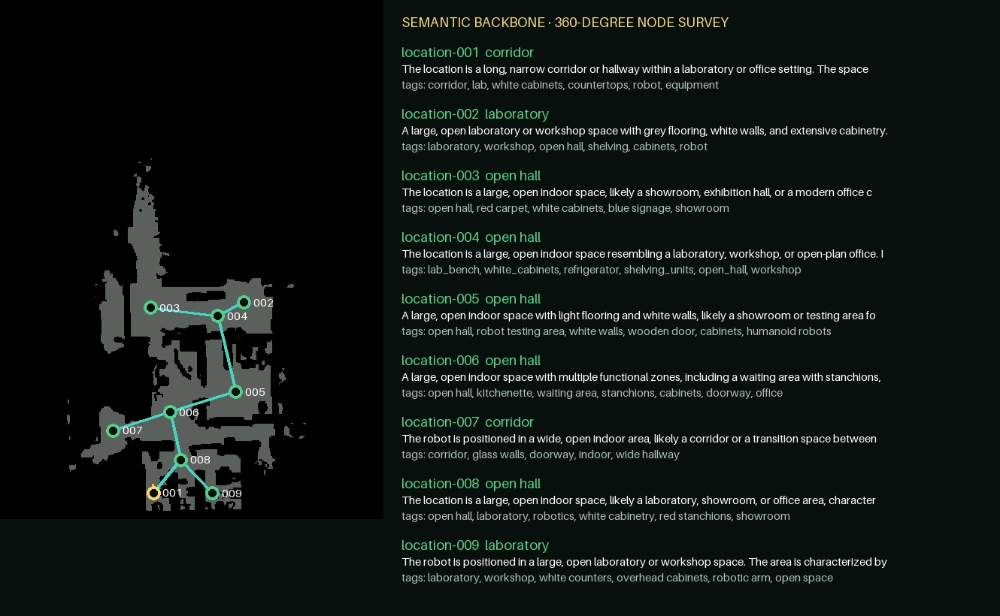
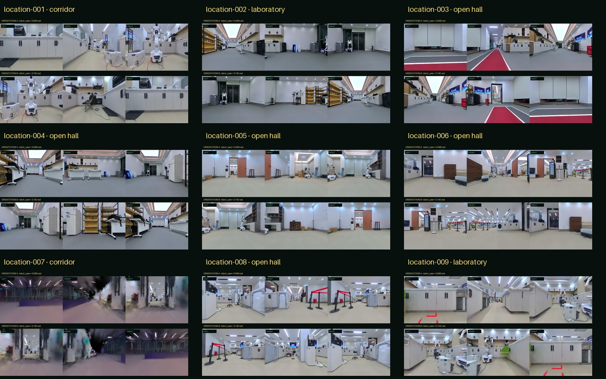
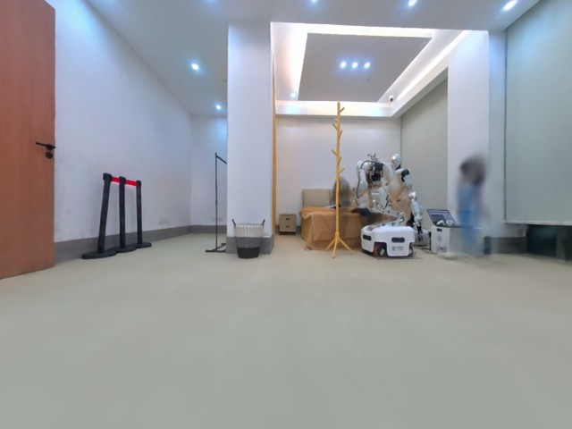
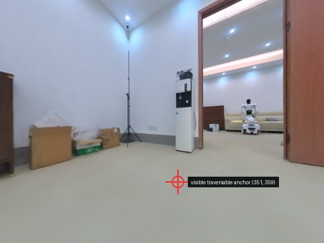
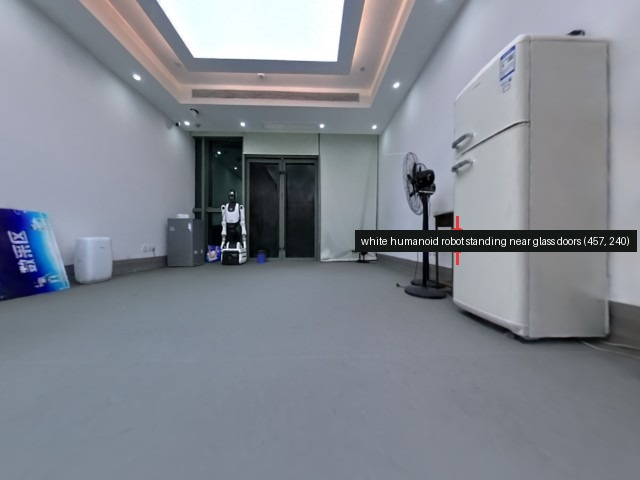
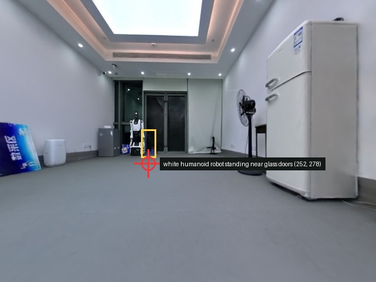
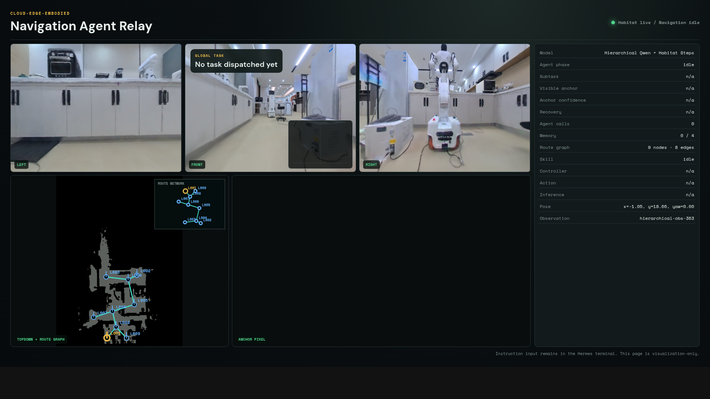

# Anchor Agent 完整开发时间线

> 本时间线强调演进过程。当前有效能力、历史实验和已回滚方案会同时保留，并明确状态。

## 阶段 0：项目定位与 P0-P3 基础（2026-08-06）

### 动机

原 CEE-Nav 已包含 Habitat、机器人桥接、OmniNav 服务和 Web Relay，但同时带有历史状态机、兼容字段和
控制逻辑。新项目需要建立独立的机器人 Agent Harness，不能把局部导航系统直接改造成全局 Agent。

### 关键决策

1. 项目新建于 `/home/jianghaoge/CEE-AgentOS`，不复制 CEE-Nav 旧状态机。
2. Agent 架构参考 ABot-AgentOS；ABot-N1 只作为未来导航基础模型候选。
3. Hermes 负责会话、Provider、模型工具循环和插件；AgentOS 负责具身规划、Skill Runner、验证、Memory。
4. OmniNav STOP 仅结束一次 Skill Run；全局任务必须经过 Finish Verifier。
5. 所有异步结果绑定 `episode_id/task_id/plan_revision/skill_run_id/observation_id/timestamp/deadline`。

### 实现

- 建立 `agentos/core`、`schemas`、`providers`、`skills`、`verification`、`memory`、`embodiments`、`api`、
  `observability`、`web`、`tests`、`docs` 和 `evals` 结构。
- 定义 Pydantic 协议：Task、Observation、SkillRequest、SkillResult、VerificationResult、Event、Trace。
- 实现事件总线、权威状态机、取消、超时、过期结果丢弃、重试和有限重规划。
- Mock Skill 完成 `IDLE -> PLAN -> START_SKILL -> EXECUTE_SKILL -> VERIFY -> DONE` 全周期。
- 接入 Qwen OpenAI-compatible 与 Gemini HTTP Provider，通过配置切换。
- 检查 CEE-Nav 的稳定接口，只提取 `/eval`、`/reset`、`/health`、`/step`、pose、trajectory 和 STOP 证据字段。

### 产物与验证

- `docs/architecture.md`、`docs/protocol.md`、`docs/state_machine.md`、`docs/non_goals.md`。
- `scripts/run_mock_task.py` 和完整单测入口。
- 当前独立项目的基础代码最终包含在 `2ce1efa` 初始 Git 基线中。

## 阶段 1：Habitat-GS 边界验证（2026-08-06 至 2026-08-07）

### 目标

先验证 AgentOS 生命周期能够驱动真实 Habitat-GS 观测和有界动作，不把云端模型、OmniNav 和控制器问题
混在同一个测试中。

### 实现与结果

- 新增确定性的 `HabitatNavigationSkill`。
- 读取前/左/右 RGB-D、pose 和 topdown，执行一次有界 Habitat 动作序列，再采集第二次观测。
- 要求 Runtime 最终为 `DONE` 且 Habitat pose 确实变化。
- 生成 sensor sheet、contact sheet 和 summary JSON。
- 建立 Hermes 插件、AgentOS 任务入口、能力查询、状态查询和 Web Relay 基础链路。

### 过程证据

- [Habitat 传感器拼图](assets/early_validation/habitat_sensor_sheet.png)
- [Habitat 动作前后联系图](assets/early_validation/habitat_smoke_contact_sheet.png)
- [Hermes 观测接入拼图](assets/early_validation/hermes_observation_contact_sheet.png)

## 阶段 2：Minimal VLN 与 Provider 延迟实验（2026-08-10 至 2026-08-13）

### Minimal 版本

用户要求一个“仅暴露 step 和 observe”的独立版本，用于测试大模型直接控制的下限：

- 单前视图，模型不可见 pose、depth、map、collision、waypoint 和外部记忆；
- `observe()` 返回 640 x 480、HFOV 120°、VFOV 90°；
- `step()` 每次只执行一个原子动作：STOP、前进 0.25 m、左转 15°、右转 15°；
- 独立端口：Habitat `8770`、Relay `5915`；
- 独立 Hermes home 和插件，不影响 Omni 或分层版本。

### 相机调整

单视图先用于减少视觉 token；随后根据用户要求把视野扩展到 HFOV 120°、VFOV 90°、640 x 480。
后续分层版本切回三路视图，并确认三路参数一致。

### Gemini Flash

- 新增 Gemini Flash 配置和启动脚本，修复默认脚本仍指向 Qwen 的配置问题。
- 将 API Key 改为环境配置使用；报告不保存密钥。
- Gemini 免费层对目标模型限制约每分钟 5 次请求，而 Hermes 一轮可能产生 3-10 次调用，出现 HTTP 429。
- 结论：Provider 可切换，但免费层无法支撑持续 Agent 会话，稳定测试切回 Qwen。

### 资源问题

排查过多 Habitat/Hermes/Relay 进程、GPU/内存占用和 pip 缓存。清理 pip 缓存只释放磁盘，不解决运行时
内存或 GPU 争用；后续启动流程逐步改为停止旧服务、固定端口和单实例运行。

## 阶段 3：Agent 监督 OmniNav 原子能力（2026-08-12 至 2026-08-13）

### 用户提出的宏观循环

1. 全局任务开始时，Agent 基于三路视图拆出当前最可能的可见子目标。
2. 子任务统一写成 `Navigate towards <visible anchor>`。
3. OmniNav 在内部逐帧运行，期间不调用任务级 LLM。
4. 每次 OmniNav 结束后，从完整轨迹取最多 4 帧关键帧。
5. Agent 联合全局任务、上一子任务、轨迹关键帧、当前三视图和记忆判断完成情况。
6. 生成下一锚点，或由独立完成判断输出全局 STOP。

### 实现边界

- OmniNav 被封装为 `NavigationSkill`，本地 STOP 只写入 SkillResult。
- Agent 在子任务前后调用，不在 OmniNav 控制周期中调用。
- Web Relay 恢复三视图，Topdown 缩小以尽量放入单页。
- Agent 输出压缩为 Previous、Next、Progress 和可选 Final，限制上下文增长。
- Omni 版本启动时重置 episode，避免测试沿用旧起点。

### 局限

OmniNav 是端到端局部模型，内部规划和轨迹可解释性有限。为了验证锚点、深度、路径和控制各阶段，后续建立
独立的分层版本，而不是修改 Omni 和 Minimal 的协议。

## 阶段 4：分层 Anchor Agent v1（2026-08-13）

### 新版本定位

建立第三个独立 profile：`hierarchical`。它与 `omni` 和 `minimal` 并存，使用独立端口、Hermes 插件、
日志和启动脚本。

### 最初 Skill 链

```text
Qwen 锚点像素
  -> Habitat 深度反投影
  -> Navmesh/A* 路径
  -> Pure Pursuit 执行
```

锚点标注图必须持续显示在 Web Relay，不能在下一轮消失。Task Agent 最初可见多个低层工具，导致它反复
observe、猜 observation ID、尝试 ground 和 navigate，形成工具循环。

### Pure Pursuit 问题和切换

用户观察到机器人像“瞬移”到目标，且缺少可以让 Agent 判断刚才发生了什么的关键帧。虽然 Pure Pursuit
理论上逐步执行，但在 Habitat 离散动作和路径跟踪之间存在表现不直观的问题。于是改为：

- 保留 Habitat PathFinder 最短路径；
- 使用 greedy geodesic follower 产生原生单步动作；
- 每个控制周期只执行一个动作；
- 完整轨迹均匀保留最多 4 张关键帧；
- 执行完成后自动采集新三视图。

### 真实验证

- 路径 2.83 m；
- 2 个几何路径点；
- 12 个 Habitat 原生动作；
- 实际移动 2.40 m；
- 0 碰撞；
- 0.43 m 剩余距离，满足 0.5 m 容差；
- 关键帧索引 0/4/8/12。

## 阶段 5：Web Relay 布局连续迭代（2026-08-13）

### 用户反馈驱动的变化

1. Topdown 太大，先缩小以保证主要信息在一页内。
2. 将 Topdown 和锚点图放到三视图下方。
3. 第二行看不清，再放大高度和锚点区域宽度。
4. 用户明确不需要全屏查看，移除点击全屏行为。
5. 图片没有填充面板，改为在保持比例下尽量填充可用区域。
6. 在 Topdown 上叠加后续的稀疏路网和自适应局部 inset。

所有中间版截图都保留在 `assets/web_layout_iterations/`，不是只保留最终版。

## 阶段 6：自动后观测与延迟优化（2026-08-13 至 2026-08-14）

### 原问题

一次导航结束后，Agent 先调用 observe，等待模型理解“必须观测”，再发起下一次锚点决策。这是一个纯协议性
动作，却额外消耗一次模型调用、约 1.1 s Agent 时间和一组消息/token。

### 修改

- `navigate_to_visible_anchor` 在执行完成后自动采集同步三视图；
- 工具结果一次返回锚点图、最多 4 张轨迹关键帧和最新三视图；
- Agent 不再在子任务之间显式调用 `hierarchical_observe`。

### A/B 数据

- 同一起点、同一找床指令，修改后 22 次导航找到床；
- 指令到首个动作 3.940 s；
- 19 个非压缩子任务切换平均 3.333 s，中位数 3.296 s；
- 旧流程平均 4.166 s；
- 自动观测和打包平均 0.310 s；
- 仅初始阶段显式 observe 一次，中间为零次。

### 压缩干扰

三次上下文压缩共 37.596 s，其中两次造成 24.820 s 和 18.071 s 的切换异常值。这个现象推动后续从
“依赖 Hermes 压缩”转向“Provider 请求前确定性裁剪”。

## 阶段 7：Scene Memory v1 实验、分支与回滚（2026-08-14）

### v1 设计

- 任务范围内按 pose 距离和语义重叠匹配场景；
- 记录访问次数、已尝试锚点和最近执行状态；
- 任务结束/reset 时清空；
- 无额外模型调用，场景描述由原有决策一并产生。

### 实验结果

- 21 次访问、10 个唯一场景；
- 6 个场景发生重访；
- 11 次访问是重复位置；
- 19 次成功导航和 2 次路径失败后，上下文容量溢出；
- 普通切换延迟 4.741 s，差于稳定自动观测版的 3.333 s；
- 任务未完成。

### 根因

每轮仍保留 8 张图片，同时完整场景描述和累计 scene index 在历史工具结果中重复。虽然 Scene Memory 能识别
“来过”，但信息过多且缺少确定性重访代价，反而干扰锚点选择。

### 版本操作

1. 建立 `2ce1efa` 稳定基线和 tag。
2. 在 `experiment/bounded-visual-memory` 提交 `ee381c7`，只暴露 scene ID + semantic tags，暂不移除历史图。
3. `2938998` 将 Scene Memory 移出 Habitat，放到独立 Agent Runtime `8767`，保持 Embodiment 无记忆。
4. 一度把 `2938998` 快进合入稳定线，并用 `2b69252` 更新文档。
5. 用户确认效果变差后，禁用场景记忆并修复图片历史累积。
6. 最终确认 `2ce1efa` 才是权威稳定版本，回滚稳定分支并删除临时实验分支/tag。

该实验代码和结论在报告中保留，但不是当前激活架构。

## 阶段 8：第一版有界视觉上下文（2026-08-14）

### 修改

- 保留原始用户任务和最近一轮 assistant tool-call/result；
- 每轮结束后确定性移除更早工具结果中的图片，不增加 LLM 调用；
- 4 轮模拟中活跃视觉历史始终只有最新 8 张图；
- 修复模型把 `next_observation_id` 当请求字段的兼容问题。

### Token 数据

- 新会话 20 次 API 调用、14 次成功导航，累计输入 239,515；
- 基线 25 次调用、累计 589,771；
- 新会话平均 11,975.75，峰值 24,470；
- 基线平均 23,590.84，峰值 49,972；
- 新会话未完成任务，不能据此宣称成功率提升。

### 暴露的新问题

图片减少后，任务仍在洗衣/工具间提前结束。原因不是上下文上限或轮数，而是模型输出普通文本但没有工具调用；
Hermes 把 API 的 `finish_reason=stop` 当成会话轮结束。

## 阶段 9：强制工具与 Stop Guard 失败实验（2026-08-14）

### 尝试

- 活跃导航任务期间设置 `tool_choice=required`；
- 限制为 navigate 和 finish 两个工具；
- 禁止并行工具；
- 增加 Stop Guard，只有 `finish_navigation_task` 成功才清除 active 状态；
- 为终端增加 Previous、Next、Progress 和 Final 短文本；
- 逐步把输出上限从 256 调到 384，再到 1024。

### 失败

- deferred tool search 没有把直接工具名加入执行器有效集合；
- 出现 `Unknown tool 'navigate_to_visible_anchor'`，重试 3 次后部分停止；
- `finish_reason=length` 仍可能在结构化工具形成前发生；
- 强制工具导致 Hermes 推理文本只显示 `...`，调试可读性下降。

### 结论

用户要求切回稳定版。所有未提交 stop guard、强制工具、输出限制和 SOUL 变更被移除，分支重置到
`2ce1efa`。该实验说明全局 Finish Verifier 必须在 AgentOS Runtime 中形成稳定协议，不能只靠 Hermes
请求中间件强制。

## 阶段 10：主动视角、语义地点与共享点位导航（2026-08-14）

### 主动视角 Skill（`dee4b99`）

- 增加 `turn_left/turn_right/move_forward/move_backward` 单步视角调整；
- 拒绝过期 observation ID；
- 直接返回新三视图，不再额外 observe；
- 实测左转 15°，无平移和碰撞；64 项测试通过。

### 语义定位地图（`6431b36`）

- 将场景摘要和语义标签绑定到当前世界 pose/yaw；
- 0.75 m 内地点合并，返回最多 24 个近期地点；
- 自动记录锚点导航结束位置，无额外 Agent 调用；
- Memory 归 AgentOS 所有，reset/finish 清理任务层；66 项测试通过。

### 历史地点导航（`712c64a`）

- 增加 `navigate_to_known_location`；
- 解析保存的世界点，复用 Navmesh 规划和原生单步执行；
- 实测前进约 1.0 m 后返回 `location-001`，16 个动作、0.8 m 执行、剩余 0.20 m；68 项测试通过。

### 共享 Point Navigation（`9cd3997`）

- 可见锚点链改为 `AnchorGenerationSkill -> PointNavigationSkill`；
- 历史地点直接进入同一个 `PointNavigationSkill`；
- 最新移动最多 4 帧 + 最新地图/三视图进入上下文；
- 锚点标注图保留在磁盘/Web Relay，但当时不再进入 Agent 上下文；70 项测试通过。

### 锚点优先策略（`0b21071`、`a308d8f`）

- 先制定“可见锚点优先，视角调整只作后备”；
- 随后修正为软优先：当前锚点弱、不安全、与全局路线无关或重复分支时，允许一次有目的视角调整；
- 最终 71 项测试通过。

## 阶段 11：实机迁移交接包（2026-08-17）

### 结论

迁移 Hermes 不是只复制个人配置。至少需要：

- 项目插件 `.hermes/plugins/cee-hierarchical`；
- AgentOS 代码、Schema、SOUL、配置和启动脚本；
- Hermes 源码或可重建环境；
- 对外一致的 `CEE_HIERARCHICAL_TOOL_URL` 服务；
- ROS2 pose、地图、路径规划、移动、安全门适配。

### 交接包

- 基于 CEE-AgentOS `a308d8f` 和 Hermes Agent `8f27127` / 0.20.0；
- 约 62 MB；
- 不含 Git 元数据、虚拟环境、runtime、logs、Habitat 数据、模型权重和 API Key；
- 71 项测试通过并包含文件 SHA256 清单；
- 当前 tar 和 sha256 位于项目根目录，保持未跟踪状态。

## 阶段 12：长任务上下文诊断（2026-08-17）

### 旧会话问题

会话 `20260817_101609_997a91`：

- 40 次任务模型调用、33 个工具轮；
- 累计输入 1,192,270 tokens，输出 6,877；
- 峰值单请求 55,303 输入 tokens；
- 三次压缩后仍继续增长；
- 15 条活跃导航消息约 124,578 字符；
- `exploration_memory` 每轮重复累计地点和场景摘要；
- 缺字段和无效工具调用反复触发修复。

### 根因总结

问题不是单一“图片太多”，而是四项叠加：Base64 图片持久化、累计 MemoryView、旧决策文本线性增长、
Schema 修复循环。只提高上下文上限或压缩次数无法解决。

## 阶段 13：可迁移 Agent Memory + 结构化 Task Reasoner（`4ee593f`，2026-08-17）

### 架构变化

- 从 `a308d8f` 建立 `feature/portable-agent-memory-reasoner`；
- Memory 只消费通用 pose/map/source/confidence，不 import Habitat；
- SQLite 保存图节点和文件引用；
- 完整 `exploration_memory` 改为 `MemoryDelta + bounded MemoryView`；
- 40 个地点时 JSON 仍小于 7,000 字符；
- 新增 previous assessment、route hypothesis、候选评分和 selected action；
- Runtime 确定性路由 visible anchor、known location 和 viewpoint adjustment；
- Hermes 工具面缩小到 begin/advance/finish，后续再加入只读 recall；
- 输出上限调整为 768 tokens，thinking 关闭；
- 论文 Method 初稿形成；74 项测试通过。

### Habitat 冒烟测试

- 三路 640 x 480、HFOV 120°、VFOV 90.03°；
- `begin` 返回空的有界 MemoryView；
- `advance` 执行一次左转，yaw 从 0 变为 0.261799 rad，无碰撞；
- 创建 `location-001`，revision 变为 2；
- reset 后恢复空任务。

## 阶段 14：Provider 请求真正有界（`8da1673`、`257d87c`，2026-08-17）

### 发现

第一版结构化会话仍把 Base64 放入持久工具消息。Hermes 在插件请求裁剪之前估算 token，导致请求实际只有
11k tokens，却按 64k 估算并触发压缩；压缩摘要自身又增长上下文。

### 修复（`8da1673`）

- 工具消息持久化 `cee-local-image:` 文件引用；
- 仅在 provider 请求前注入当前需要的图；
- 固定导航消息窗口：上一移动关键帧 + 当前地图/三视图；
- 旧 navigation 工具消息和配对 assistant tool call 不进入 provider 请求；
- 禁用 Hermes 自动压缩；
- 规范化字段别名、枚举同义词、过长文本、候选/动作不一致和 finish 字段；
- 40 轮与 5 轮请求都为 3 条消息、8 张图，序列化差小于 100 字符；76 项测试通过。

### 接口修复（`257d87c`）

- 公共 `advance_navigation` Schema 只强制模型提供选中动作；
- plugin 托管最新 observation ID；
- 自动补齐协议元数据，兼容自然 Qwen 别名和嵌套 action；
- 清理旧 Hermes 进程，只保留一个实例；78 项测试通过。

## 阶段 15：首帧全局锚点、关键帧 pose 和稀疏路网（`b1f6fee`，2026-08-17）

### 修改

- 每张轨迹关键帧绑定 pose、yaw、map、confidence、navigation point 和 `location_id`；
- 首帧三视图和原始指令写入 `global_anchor`；
- 指令提及的首帧物体成为后续路线假设的重要地标；
- 轨迹按 0.75 m 去重形成第一版稀疏图；
- 已知地点导航到达位置后用 Habitat 单步转向恢复历史 yaw；
- 40 轮上下文固定为首帧 3 图 + 最新 8 图，共 11 图；82 项测试通过。

### 实测

- 15 个原始 waypoints / 14 个控制动作压缩为 3 个地点；
- 4 张关键帧映射为 `location-001/002/003/003`；
- 返回 `location-001`：23 个路径动作 + 12 个朝向恢复动作；
- 最终 yaw 误差约 `5.96e-8 rad`。

## 阶段 16：路网可视化（`1dc5987`，2026-08-17）

### 实现

- Relay 暴露 `route_graph`：节点 pose/yaw、当前点、全局锚点、间距和去重边；
- Topdown 上增加透明 Canvas；
- 使用 origin 和 meters-per-pixel 将世界点映射到地图；
- Cyan 表示通行边，蓝色为地点，黄色为全局锚点，绿色为当前位置；
- 每个点绘制朝向线；
- 局部自适应 inset 放大短距离图。

### 验证

真实冒烟测试得到 3 节点、2 条边：`L001 -> L002 -> L003`，桌面和窄屏截图均保留，82 项测试继续通过。

## 阶段 17：锚点置信度、视觉召回与道路优先（2026-08-17）

### 低置信度恢复（`89fa910`）

- 初始阈值 0.60；
- 低分锚点在路径规划前拒绝；
- 决策预选“调整视角”或“返回上一地点”；
- 无上一地点时确定性调整视角；
- Web Relay 展示置信度、阈值、拒绝和恢复；84 项测试通过。

### 有界历史视觉召回（`dcd8b75`）

- 每次子任务的最多 4 张关键帧完整持久化；
- 最近一次子任务自动进入下一轮；
- 更早图片只按需召回，最多 4 张；
- 支持完整任务均匀采样、最近子任务、地点和语义查询；
- 召回包在下一导航包到达后退出活跃上下文；87 项测试通过。

### 阈值提高（`4b31e40`）

用户认为 0.60 太低，将安全阈值提高到 0.80。回归验证 0.75 会被拒绝，0.91 可继续执行。

### 可通行道路优先（`a566814`）

目标不在视野时，不允许凭空生成不可见房间作为锚点。优先选择当前图像中明确可通行的走廊、开放门洞、
连续地面或更宽阔未探索空间，再考虑视角调整。

## 阶段 18：类人探索与语义拓扑（`bffbe5e`，2026-08-17）

### 用户目标

机器人不仅要“看到目标就走”，还应在看不到目标时主动探索、识别走过的分支、必要时回退，并只记住对后续
决策真正重要的空间位置。

### 修改

- 视觉证据地点与路网节点分层；
- 路网只保留全局起点、`junction` 和 `open_space_center`；
- 普通走廊停点和密集执行路点不再进入拓扑；
- 新增 `goal_pursuit/explore_route/backtrack`；
- MemoryView 增加 pose-aware `backtrack_location`；
- `no_progress/blocked/hypothesis_rejected` 后重复探索会被 Runtime 改为回退；
- 附近普通观测不能移动或擦除已有拓扑节点属性；91 项测试通过。

### 当前判断方式

运行时 `junction/open_space_center` 主要由 Agent 根据三视图语义判断，Runtime 负责稳定和约束。静态地图几何
提取随后作为另一个互补方向出现，它不会替代运行中的语义补充。

## 阶段 19：历史地点 ID 修复（`4852c17`，2026-08-18）

### 错误

Agent 正确知道 sofa 证据在 `location-025`，但生成：

```text
target = "the beige sofa visible in location-025 at z≈18.46"
location_id = <omitted>
```

旧 normalizer 把完整 target 复制到 `location_id`，触发正则校验失败。

### 修复

从显式 location ID、action target 或 candidate target 中提取第一个合法 `location-NNN`，并保留原 target。
使用真实失败形状增加回归，完整测试 92 项通过。

## 阶段 20：静态骨干拓扑视觉原型（2026-08-18）

### 目标

在任务开始前根据 `map_id` 提取一张任务无关骨干拓扑。已提取的地图直接载入缓存，未提取的地图在任务启动
阶段生成；探索过程中再把语义、目标证据、访问状态和任务相关性补到节点上。

### 离线原型

- 地图：`1st_floor_exh`；
- Navmesh 栅格：378 x 512；
- 比例：0.0901888 m/px；
- 保留可通行连通域；
- Zhang-Suen thinning 得到单像素 medial skeleton；
- 用 12 px（约 1.1 m）径向环验证稳定多分支，过滤锯齿边界假岔路；
- 局部 clearance 极大值作为开阔区域中心；
- 输出 1,891 个骨架像素、3 个岔路和 5 个开阔中心。

### 状态

该结果是可复现离线原型，尚未修改在线 Runtime。过程图、节点 JSON 和提取脚本均在报告附件中。

## 阶段 21：骨干拓扑在线加载与可编辑语义地图（2026-08-18）

### 从原型到 Runtime

离线骨架提取随后接入任务启动流程。几何输入先经过可迁移的 Navigability Map Provider：Habitat 从
Navmesh 生成可通行栅格，实机侧可由 ROS2 OccupancyGrid 或 SLAM 地图实现同一接口。拓扑缓存按
`map_id + geometry_revision + extraction parameters` 标识，因此 Agent Memory 不依赖 Habitat 真值类型。

- `1st_floor_exh` 使用前一轮确认的参数固定得到 8 个骨干节点和 8 条边；
- 首次载入生成缓存，后续启动命中缓存，不重复提取；
- `reset` 清理任务级视觉/执行记忆，但会重新载入地图骨干，并将本轮启动位加入地点表；
- 当前禁止运行时任意创建骨干节点，除全局起点外，只能给既有骨干节点补充语义；
- 只有与任务明显相关且置信度不低于 0.90 的语义更新才写入拓扑节点；
- Web Relay 在 Topdown 上叠加固定节点、连边、全局起点和当前位置。

这里经历过两次关键纠正。第一版把拓扑提取和缓存放进 `HabitatGSAdapter`，这会让 Agent Memory 与模拟器真值
耦合；随后移到 Mapping 层的 `NavigabilityMapProvider`，由 Habitat Navmesh、ROS2 OccupancyGrid 和静态测试
Provider 分别生成统一 `NavigabilityGrid`。Embodiment Adapter 重新只负责观察与运动，骨干 extractor、cache、
task-start overlay、语义层和 Agent Memory 可以跨仿真/实机复用。

第二次纠正来自真实启动。第一版在线参数在 `1st_floor_exh` 上达到 24 节点上限且全部被错误判成 junction，之后
恢复离线原型验证过的 Zhang-Suen thinning、12 px 稳定分支环和 3 junction + 5 open-space-center 参数。启动脚本
先调用 `/reset` 时还曾让 Web Relay 短暂显示 0 节点；修复后 reset 本身就加载缓存、创建起点并返回完整路网，
无需等第一条任务。


### 地点中心语义

节点语义不再严格绑定 LEFT/FRONT/RIGHT 某个瞬时朝向，而是描述人在该地点的整体认知：这里是什么场所、
主要功能、可见物体、显著地标、空间特征，以及它对哪些任务有用。每个节点可以通过多朝向观测、遥控遍历或
点位遍历逐步完善。

语义数据保存于 `runtime/semantic_maps/<map_id>.json`，核心字段包括 `place_type`、`function`、`objects`、
`landmarks`、`spatial_character`、`task_affordances`、`aliases`、`confidence` 和 `source`。JSON 可由人直接
修订；人工修改 `place_type` 不会伪造视觉 `objects`。本轮最终把 `backbone-003` 修正为 bedroom，并恢复
此前误改的 `backbone-005` 场所类型。

语义底稿不是单帧猜测，而是一次完整固定骨干巡检：实际走完 9 个路由点和 11 个连通导航段，每个节点采集到达
朝向三视图，再旋转约 180 度采集第二组三视图，共 54 张图。Qwen 根据六视图拼图生成地点、功能、物体、地标、
搜索线索、置信度和不确定性，之后再转换为 orientation-invariant `NodeSemantics`。Web Relay 只保留节点编号，
另有一张独立“节点位置 + 语义字段”审阅图用于人工修订 JSON。

| 语义骨干地图 | 节点多方向观测 |
| --- | --- |
|  |  |

## 阶段 22：Node-first 语义导航层级（2026-08-18）

### 任务分解

该层级是在调研 ABot-N0 的 Block/Road/Function/Object 与 Approaching -> Reaching -> Self-Reflector 设计后落地：
固定骨干边对应 Road，bedroom/kitchen/office 对应 Block/Function，bed/refrigerator 等对应最后一段 Object/POI。
这使“已知区域 Point Navigation”和“区域内视觉 Anchor Search”成为两个明确阶段。

自然语言任务先被拆为 `destination_query` 与 `object_goal`，再形成三阶段路由：

```text
approach_node -> local_anchor_search -> verify_goal
```

例如 `go to bedroom to find the bed` 不再直接在全图反复生成 bed 锚点，而是：

1. 用 `destination_query=bedroom` 检索语义骨干并选中 `backbone-003`；
2. 通过共享 Point Navigation 到达该节点；
3. 在节点附近探索并用视觉 bbox/锚点寻找 `object_goal=bed`；
4. 只有 Agent 明确切换节点时，才离开当前局部搜索范围。

`topology_node_id` 表示固定地图节点，`location_id` 表示某次历史观察位。后者不再参与场所主路由，只在去
节点途中曾看到目标、到达节点后因朝向变化看不到时，作为视觉证据回访补充。

Hermes 侧进一步执行严格 B/L 投影：固定节点只暴露 `backbone-XXX`，route graph 的 edge endpoint 也重写为 B
ID；只有真实关键帧和历史观察位暴露 `location-XXX`。每个 L 点保存 pose、yaw、导航坐标及三视图引用，完整图片
留在服务端按位置召回，自动上下文只携带最近完整子任务的最多 4 张轨迹帧。

### 三视图真实归属

Node-first 接入过程中还发现 planner 的 `view` 缺失会默认 FRONT，导致目标实际位于其他相机时仍被迫在前视图
生成锚点。grounding 随后改为同时检查同步 LEFT/FRONT/RIGHT，由 Qwen 返回真实 panel index；不可见目标返回
`anchor_visible=false` 和零置信度。深度、点位导航、标注文件与 Web Relay 均使用实际选中的相机，不再信任
planner hint。这个修复解决“用哪张图”，阶段 26 的 bbox 修复则解决“图中坐标如何解释”。

### 局部空间约束

- 节点局部搜索半径默认 5 m；
- 像素深度超过 5 m 时，保留原投影射线方向并截断到 5 m，而不是导航到过远或跨房间点位；
- 锚点世界点如果超出当前语义节点局部范围，也按同一半径截断；
- 到达历史 `location_id` 后恢复记录的 yaw，再从当前三视图生成新的目标锚点。

本轮曾因语义 JSON 错配让 bedroom 命中错误节点；修正节点语义并统一 `topology_node_id/location_id` 后，
同一任务稳定先命中 B003，再进入局部 bed 搜索。

| 任务启动观测 | 到达 bedroom 节点后的局部观测 |
| --- | --- |
|  |  |

## 阶段 23：可见目标语义传递修复（2026-08-18）

### 故障

在 `obs-1123/obs-1202` 中，Agent 的文本推理和历史关键帧都已识别 bed，但旧 Hermes 请求使用嵌套字段
`selected_anchor.semantic_hint="bed - tan/brown bed cover"`。请求规范化器只保留了
`action_type=visible_anchor`，没有把语义目标提升到平坦的 `action.target`，最终默认成泛化的
`visible traversable anchor`。因此 Qwen grounding 正确执行了错误的语义请求，把普通地面当成锚点。

### 修复

- legacy `selected_anchor` 的 action type、semantic hint、description 和 view 会提升到当前协议；
- `expected_evidence` 与 `success_condition` 同步保留；
- Prompt 要求 `action.target` 始终携带目标物精确身份；
- `find/locate` 任务仍允许按 Agent 判断继续靠近，没有增加强制“看见即结束”规则。



## 阶段 24：长任务上下文与用户可感知延迟复盘（2026-08-18）

对最近完成的 bedroom 找床任务进行逐消息审计：

- 最终一次模型调用输入 26,248 tokens，10 次调用累计输入 159,941 tokens；
- 当前视觉窗口为首帧三视图、最近完整子任务的 4 张轨迹关键帧和当前三视图，共 11 张图；
- 11 张图约占 3,369 tokens（12.8%），主要增长已转为重复结构化 JSON；
- begin payload 约 8,378 tokens，其中 route graph 与 MemoryView 约 5,477；
- 最近导航 decision/result 对约 9,736 tokens，其中结果 JSON 约 6,012；
- 整个任务 71.80 s，Habitat 控制 34.66 s，非控制开销 37.14 s；
- 10 次 Agent 调用共 31.50 s，稳定的子任务后复盘平均约 4.55 s；
- 指令到首次真实动作 19.84 s，最大异常来自一次 15.2 s 的无效工具参数生成。

结论是：历史图片已不再无限累计，但 MemoryView、完整 route graph、trajectory result 和工具 schema 仍需要
进一步压缩。后续优化不应简单删除关键帧，而应让图像按“首帧 + 最近完整子任务 + 当前观测 + 按需召回”保留，
同时缩减重复结构化文本。

## 阶段 25：Node/Point Navigation 原子执行（2026-08-18）

### 64 步边界的重新定义

原来的 `max_control_steps=64` 被错误地暴露成一次工具结果边界。目标节点未到达但 64 步耗尽时，Hermes 会
重新进入 Agent 推理，虽然语义目标和路径都没有变化。这既增加约 4-5 s 切换延迟，也扩大上下文。

现在 64 步只作为 Runtime 内部控制安全分块：健康的预算耗尽会在 Skill 内自动观测、刷新同一目标路径并继续，
不会返回 Agent。只有到达节点、持续卡住、路径失效、取消/超时或未来的高置信语义事件才重新进入 Agent。
完整点位任务还保留 300 s、1000 动作和 Cancellation Token 总安全界限。

### 实测

从 reset 起点导航到 `backbone-003`：

- 内部分块：64 + 17；
- 总动作：81；
- 里程：12.816 m；
- 终点剩余距离：0.219 m；
- 轨迹关键帧：`[0, 21, 64, 81]`；
- 总耗时：30.597 s；
- 第 64 步没有发生 Agent 调用。

结果对外仍是一次 `completed/reached` Point Navigation，并附带 `execution_chunks` 与
`termination_reason`，轨迹四帧覆盖完整 node 任务而非单个控制分块。

## 阶段 26：三视图 bbox 锚点坐标回归修复（2026-08-18）

### 复现与根因

任务 `white humanoid robot standing near glass doors` 中，Qwen 正确判断目标位于 RIGHT、置信度 0.95，
但 Web Relay 红点落在冰箱 `(457, 240)`。重放同一 `obs-1274` 后得到模型原始输出：

```text
panel_index=2, x=715, y=500, coordinate_space="pixels"
```

单路图只有 640 x 480。旧代码发现坐标越界后，静默把它们改当局部 `0..1000` 坐标，恰好换算为
`(457, 240)`。因此错误不在目标识别或 View 判断，而在“模型自报坐标空间 + Runtime 猜测修复”的模糊契约。

### 修复

- LEFT/FRONT/RIGHT 改为三张独立、带 panel 标签的输入，避免超宽三联图坐标混淆；
- Qwen 只返回所选单图内固定 `0..1000` 的目标 bbox，不再自行选择 coordinate space；
- Runtime 将 bbox 映射到 640 x 480，并在 bbox 底边中心下方生成确定性地面导航点；
- 黄色框显示视觉目标，红色十字显示真正用于深度投影的地面点；
- min/max 反序会被自动整理，零面积 bbox 才被拒绝。

同一帧复测得到 bbox `[240, 220, 265, 268]` 和地面点 `(252, 278)`，准确落在机器人脚前。

| 修复前：冰箱错误点 | 修复后：目标 bbox 与脚前地面点 |
| --- | --- |
|  |  |

新增 RIGHT 视图、三图输入、bbox 转换和锚点输出回归。完整测试 111 项通过；Habitat 8766、Hermes 和
Web Relay 5916 已重新启动。

## 阶段 27：Node-first 首轮联合决策审计（2026-08-18）

### 最近完成任务

审计 Hermes 会话 `20260818_171530_0ac6a4` 中的任务 `go to office to find a white fridge`。Runtime 在 begin
阶段将任务拆为 `destination_query=office` 和 `object_goal=white fridge`，但首轮只用 destination 检索语义
节点，因此以 0.992 选择 B001 `office area`。机器人到达 B001 后进行了两次局部锚点探索，Agent 才从语义
地图中发现 B002 已记录 `refrigerator`、`tall white refrigerator` 和 `navigate to refrigerator`，随后切换到
B002 并完成任务。

B001 与 B002 在当时的骨干图中直接邻接。这个结果说明 B002 不是错误漂移，而是与 office 地点节点关联的
目标物证据节点；真正的问题是这些信息在首轮已经存在，却没有参与初始路由。

### 修正后的层级定义

Node-first 需要同时保留两个角色：

- `place_node`：通过场所类型或功能匹配，例如 office -> B001；
- `object_evidence_node`：通过物体、地标和 affordance 匹配，例如 white refrigerator -> B002；
- `execution_node`：结合场所关联和拓扑距离后，本轮真正执行的节点，可直接选择 B002。

候选排序应联合地点关联、目标物短语匹配和骨干图邻接，而不是只增强 `place_type` 权重。完整日志还暴露出
中文地点词无法命中英文语义、`fridge/refrigerator` 同义词缺失，以及探索锚点到达后过早进入
`verify_goal` 等待实现项。

本轮总耗时约 100.18 s，其中工具执行约 63.4 s，Agent/工具准备约 36.8 s；11 次模型请求累计输入
220,158 tokens。若首轮直接选 B002，可以减少 B001 后的两次锚点探索和一次节点重规划。完整审计见
[`node_first_office_fridge_audit_20260818.md`](evidence/node_first_office_fridge_audit_20260818.md)。

## 阶段 28：Skeleton 约束骨干建边修复（2026-08-18）

### 跨墙假边

在线骨干节点来自 medial skeleton，但旧 `sparse-backbone-v2` 的最后一步在同一自由空间连通分量内使用欧氏
最小生成树建边。它只保证整张地图最终连通，不保证一条边沿真实通道相邻。用户在 Web Relay 中发现
`location-004 -> location-005` 直线穿过不可通行区域；对应固定节点 B002-B003 的欧氏距离为 6.956 m，
实际 skeleton 路径达到 21.383 m，说明两者不应是直接拓扑邻居。

### 修复

- 提取器升级为 `sparse-backbone-v3`；
- 在 medial skeleton 上执行多源 Dijkstra，按最短路 Voronoi 区域是否相接决定节点邻接；
- `distance_m` 改为 skeleton geodesic，而非节点欧氏距离；
- 每条边保存经过自由空间验证并简化的 `path_world_xy_m` 折线；
- Web Relay 沿折线绘制，合法弯曲通路不再被画成穿墙直线；
- Hermes 输出投影删除折线几何，只保留节点和边关系，避免增加 Agent 上下文。

### Habitat 验证

真实 `1st_floor_exh` 重新提取后，8 个节点的 ID、位置和语义保持不变，新缓存键为
`63271126e56dc000b09a`。B002-B003 假边已删除，当前固定边为：

```text
B000-B001  B000-B002  B001-B002  B001-B004
B003-B004  B004-B005  B004-B006  B006-B007
```

运行时显示 8 条固定骨干边，加 1 条任务起点附着边。语义地图仅同步新缓存键，8 个 place/object/landmark
记录未被改写。完整测试增至 112 项通过，Habitat 8766、Web Relay 5916 和 Hermes 均已重启。

| 修复前：欧氏 MST 跨墙直线 | 修复后：Skeleton 邻接与折线路径 |
| --- | --- |
|  |  |

新版缓存见
[`1st_floor_exh-63271126e56dc000b09a.json`](evidence/topology_edge_connectivity_fix_20260818/1st_floor_exh-63271126e56dc000b09a.json)。

## 阶段 29：混合 Skill 仲裁与动作可观测性（2026-08-19）

### 问题

在 B002 白冰箱任务中，Hermes 的解释文本已经判断应切换节点，但结构化请求仍选择普通可见锚点。Runtime 不从
自由文本提取运动命令，因此实际动作与屏幕上的推理不一致。另外，预载的环境语义曾错误地把所有固定节点标记为
“本任务已探索”，使节点候选仲裁失效。

### 实现

- 固定节点的任务访问状态与环境语义预载解耦；
- Runtime 联合目标相关节点、可信视觉锚点、L 点回访和视角调整选择最终 Skill；
- L 回访与视角调整处于同一级别，不再无条件以回退覆盖主动观察；
- 默认视角调整从 15 度改为 90 度，并由 Habitat 六次 15 度原生动作累计完成；
- 工具结果新增 `executed_action`，明确报告 `NODE_NAV / VISUAL_ANCHOR_NAV / L_REVISIT /
  VIEWPOINT_ADJUST`、实际目标和动作来源；
- Hermes 每轮优先用三行以内报告实际执行，而不是重复长篇推理。

### 被撤回的尝试

曾增加“每个节点最多两次局部锚点探索”的固定预算，希望避免局部循环。该规则会截断走廊、转角、沙发、木门、
卧室、床等需要多个连续锚点的因果链，因此完整撤回，未进入稳定协议。

### 验证

混合动作、四种执行模式、Runtime 覆盖和低置信锚点恢复均增加回归测试。阶段性完整测试从 114 增至 115 项通过。

## 阶段 30：关系感知的语义节点排序（2026-08-19）

### 动机

字符串匹配无法稳定处理 `fridge/refrigerator`、多语言表达或同一物体出现在多个场景。更重要的是，
`find the robot in the kitchen` 表达的是“目标物与目标场所的所属或功能关联”，不是两个独立关键词。

### 实现

任务开始时增加一次有界 Qwen 文本排序：只向模型提供任务拆分结果和固定节点的紧凑语义文档，要求按 JSON
Schema 返回一个已存在节点、置信度、命中概念和选择理由。Prompt 显式定义：

```text
object_goal located_in_or_associated_with destination_query
```

模型联合读取节点 `place_type/function/objects/landmarks/affordances`。相似物体出现在多个节点时，场所和功能
一致性优先；没有联合证据时退回目标场所作为局部探索区域。Provider 失败或低置信时仍有确定性本地检索降级。
自动 object-evidence 节点切换只允许发生在已选场所节点的骨干邻居中，避免跳向远处不相关同类物体。

### 验证

真实 `1st_floor_exh` 八节点输入中，`find the robot in the kitchen` 选择 B006，置信度 0.90，并联合引用
kitchen、robotic equipment、robotics 和 robot demonstration。该结果验证了关系绑定，而非单词命中。

## 阶段 31：环境级语义骨干冻结（2026-08-19）

### 生命周期修正

固定骨干从“每个任务可变化的 Memory 子图”改为“服务生命周期只读环境模型”：

1. 服务启动时通过 Mapping Provider 和缓存读取或构建一次 topology；
2. 语义 JSON 只加载一次；
3. begin/reset/finish 只把同一冻结模型重新物化到新任务 Memory；
4. 不重新提取地图、不重新读取或写入 JSON；
5. 不把任务启动 pose 加入固定节点；
6. 不再从 `advance_navigation` 自动提升节点 objects/landmarks/affordances；
7. 手工修改 JSON 后必须重启服务，`reload_semantic_map` 在运行中明确 no-op。

首帧三视图仍是任务级全局视觉锚点，可以按 L 位置回访并恢复朝向，但 `is_route_node=false`，不会污染 B 图。
等价平面 Navmesh 的 revision 兼容只在内存中重绑定，避免为了适配 Habitat 重写人工编辑的语义文件。

### 验证

真实 reset/begin 验证保持 8 个固定节点，route graph 不含 start/global 节点；磁盘语义 JSON mtime 不变。
环境级 node ID、场所属性和 skeleton 边在任务切换后保持一致。

## 阶段 32：Reset 从 Agent 工具边界移除（2026-08-19）

`/reset` 保留为服务端运维端点，但不注册到 Hermes。Agent 只能访问 begin、semantic search、visual recall、
advance 和 finish 五个任务级工具。启动脚本也改为默认不 reset；只有显式设置
`CEE_HIERARCHICAL_RESET_ON_START=1` 才在打开 Hermes 前重置 Habitat。

实测在不设置该变量时重启 Hermes，服务端 `task_id` 前后完全一致。这样交互窗口重开不会再意外改变机器人现场，
同时人工测试仍可显式请求可复现起点。

## 阶段 33：固定语义骨干稳定基线（2026-08-19）

本阶段把此前未提交的在线骨干、Skeleton geodesic 建边、三视图 bbox grounding、原子 Point/Node Navigation、
可迁移 Agent Memory、关系节点排序和 Reset 隔离统一保存为可回滚版本。完整测试 **122 项通过**，
`git diff --check` 通过。

该基线仍采用 Node-first 混合策略。后续“节点仅作为地域认知、连续视觉锚点主导执行”的方案将在独立实验分支
实现，避免直接覆盖当前可运行版本。

## 阶段 34：拓扑引导的连续视觉锚点链（`574763e`，2026-08-19）

在 `experiment/anchor-chain-node-cognition` 上把固定节点从默认强制执行目标调整为地域认知与方向约束。Agent
仍需从当前三视图产生连续可见锚点，Topo 图只提供当前区域、目标区域、相邻节点、Road 连通关系和跨区提示。
显式区域切换或恢复仍可使用 B 节点导航，局部视觉推进优先使用锚点。

Runtime 增加 `RegionalAnchorGuidance`，用目标节点方向限制探索锚点 View，并把锚点最大深度同时限制在 5 m 和
当前区域边界内。Hermes 输出区分最终语义目标节点、当前地域上下文节点和历史 L 证据点。该提交修改 11 个文件，
增加 725 行、删除 461 行，为后续连通节点逐段执行奠定接口。

## 阶段 35：移除任务首帧常驻机制（`6a07b48`，2026-08-19）

上下文审计发现图像中间件会把 Hermes 会话中第一次 begin 的图像当作永久全局锚点，跨任务时可能保留旧任务
首帧。即使修正成最新 begin，持续携带三张首帧也会增加固定视觉成本。冻结语义骨干和当前 pose 已足够构成
稳定空间参考，因此实验版移除任务首帧常驻：首帧仅用于首次规划，随后由上一宏任务关键帧、当前三视图、原始
任务和 Topo-Memory 接替。

完整视觉历史仍保存在服务端；最近宏任务最多四张前视关键帧自动参与下一轮，更早图片通过 bounded recall
按需进入。普通任务观察也不再合并到同位 `map_backbone` 节点，避免覆盖冻结语义。实验分支 125 项测试通过；
稳定 Node-first 分支同步提交 `83ef261`，并建立
`stable-frozen-semantic-backbone-no-firstframe-20260819` 回滚标签。

## 阶段 36：连通节点逐段推进（`6027a27`，2026-08-19）

第一版地域引导会按每轮最近节点重新计算路线，机器人偶然靠近后续节点时可能跳过中间连通段。当前将骨干路线
保存为有序 `route_node_ids`，并增加 `route_progress_index`、下一/目标节点距离、节点到达半径和
`target_region_reached`。只有进入下一个相邻节点半径才推进一个索引；所有前序边完成后才允许进入目标区域搜索。

探索锚点的 View 与当前活动边绑定，深度受当前连通段剩余距离限制。三节点对抗测试把机器人直接置于最终节点，
Runtime 仍按 0 -> 1 -> 2 推进，未发生拓扑跳步。真实 bedroom 路线检查返回
`B006 -> B004 -> B003`，阶段回归 126 项通过。

## 阶段 37：ABot-N0/N1 结构化协议调研（2026-08-19）

重新对照 ABot-N0/N1 技术报告，明确当前目标是复刻训练体系之外的功能架构，而不是只复用模块名称：

- N0：Agentic Planner、Actor、Episodic Memory、Block/Road/Function/Object-POI 四层 Topo-Memory、
  Self-Reflector；
- N1：历史前视 + 当前三视图 + 任务 + 上一决策的 Slow 输入，任务专用半结构化 CoT，target/affordance
  双像素，以及 Slow 低频、Fast 高频执行；
- AgentOS：结构化协议、事件、取消、超时、过期结果拒绝、Skill 隔离与独立 Finish Verifier。

工程约定 Qwen 为外部 Slow System，A*/Navmesh 与 Habitat/ROS2 单步控制器替代专有学习型 Fast expert。
Instruction-Following 只保留 finished/ongoing sub-instruction；Object-Goal 只保留 localization/context 与
path planning；Point/POI/Person-Following 不生成语言 CoT。

## 阶段 38：ABot-N0/N1 + AgentOS 可执行架构（`c3e49ad`，2026-08-19）

### Planner 与 Memory 顺序

`begin_navigation_task` 不再在看见当前环境前预先选节点，只接收原始任务并返回同步三视图、短期 Episodic
Memory 和四层 Topo-Memory。第一轮 `advance_navigation` 必须带 `AgenticPlannerOutput`，后续只有
Self-Reflector 设置 `should_replan=true` 时允许替换计划。

Plan 严格验证 Approaching/Point-Goal、Reaching/Object-or-POI-Goal、Interaction/Instruction-or-Person 的
阶段对应关系、粗到细顺序、活动子任务、稳定 ID、节点合法性和成功条件。原始用户任务始终为权威输入，模型不能
通过重复字段改写总任务。

### CoT 与双像素

Hermes Schema 删除公开的通用 route hypothesis、候选评分和旧 assessment。任务类型决定合法 CoT，额外字段
被 Pydantic 和 JSON Schema 双重拒绝。Qwen bbox 底部中心作为最终可见目标的 `target_pixel`；A* 路径通常
选取约 3 m 可通行前视点并投影为 `affordance_pixel`。投影经过同步深度可见性检查、5 m 深度门和连通路段限制。

### Slow/Fast 时序

Point Navigation 在 A* 规划完成、控制尚未开始时发送 `pixel_guidance_ready`。Runtime 立即持久化
`ABotSlowOutput`，随后 Fast 才能执行。Slow 输出、Point report 和 `ABotFastExecution` 共享同一
`slow_step_id` 与源 observation ID。测试通过控制器首步回调确认 Memory 在运动前已有该 Slow 决策。

Self-Reflector 在每个后续宏边界必填；局部 Skill 成功、A* 到达或 STOP 都不能直接结束全局任务，只有独立
Finish Verifier 能授权 DONE/FAILED。提交修改 21 个文件，增加 2465 行、删除 227 行；完整回归
**134 项通过**，compileall 与 `git diff --check` 通过。架构说明保存在
`docs/abot_n0_n1_agentos_architecture.md`。

## 阶段 39：实验版服务启动与 Qwen 恢复验证（2026-08-19）

从 `c3e49ad` 重启 Habitat `8766`、Web Relay `5916` 和 Hermes。Habitat 健康检查确认
`1st_floor_exh` 固定语义骨干为 8 节点、8 条边，语义 JSON 已载入且冻结。Hermes 使用显式
`CEE_HIERARCHICAL_RESET_ON_START=1` 回到可复现实验起点。

首次启动时 H800 的 SSH 服务在 key exchange 前关闭连接，本地 Qwen `18011` 未监听。连续诊断确认本地代码、
Habitat 和 Relay 均正常，故未误归因给 AgentOS。稍后 SSH 隧道自动恢复，`/v1/models` 返回
`qwen3.6-vl-35b`；携带 `enable_thinking=false` 的最小生成请求返回 `READY`。现有 Hermes 会话保持运行，
恢复模型时没有再次 reset Habitat。

## 阶段 40：运行日志复盘与模型/Runtime 边界纠偏（2026-08-20）

复盘 16:42 的 `go to office to find a white fridge` 完整运行。任务最终成功，Finish Verifier 在机器人距离
白色冰箱约 0.28 m 时授权完成，但整轮发生 32 次模型 API 调用和 31 个 Tool turn。日志确认主要开销来自
协议重试：两次嵌套 Planner 结构未被识别，以及多次 ObjectGoal 完成证据被 Runtime 硬门拒绝。

本阶段重新明确执行边界：场所-物体关系、任务因果进展、目标可见性、子任务完成和恢复动作选择交给 Qwen；
Runtime 只判断 ID/时间戳、Schema、pose 到达、路径连通、深度转换、碰撞、stall、deadline 和 STOP 作用域。
删除 `no_progress` 后自动回退的语义动作改写，也删除 Object/POI 完成前必须已有锚点执行证据的硬门。
PointGoal 仍使用地图 pose 与到达半径做客观验证，最终任务仍由独立 Qwen Finish Verifier 裁决。

## 阶段 41：Planner 协议容错与状态机闭环（2026-08-20）

Hermes 请求规范化器新增对 `plan.subtasks`、`target_localization`、`target_object` 和
`active_target_evidence` 等模型常见结构别名的纯结构映射。该兼容层不进行节点语义选择，只把模型已经表达的
计划恢复成严格 Pydantic Schema。HTTP 400 现在保留 Runtime 的 `next_call_contract`、最新 observation ID、
活动 subtask ID 和目标证据，避免错误后再次猜测协议。

活动 Agentic Plan 新增严格完成状态门：最终 subtask 必须先通过 `advance_navigation` 的模型 Self-Reflector
迁移到 `verify_goal`，之后才能调用 Finish Verifier。提前 finish 返回 `finish_not_ready`，不会清空任务记忆。
零步 known-location 结果标记为 `location_arrival_only`，不能被误解成 ObjectGoal 或全局任务完成。

同时将 `search_semantic_map` 从 Hermes 注册表移除。内部搜索 API 仍供诊断和评测使用，但任务级模型只看到
begin、recall、advance 和 finish 四个 Tool，节点语义决策不再有确定性关键词捷径。

## 阶段 42：长指令角色顺序与 Omni 接入审计（2026-08-20）

去除旧的 `Approaching -> Reaching -> Interaction` 固定阶段排序，只保留 stage 与 task type 的合法对应。
Planner 现在可按自然指令交错和重复角色。目的地区域 PointGoal 自动插入最终目标 Reaching 之前，前置
`Interaction(exit/turn/go straight)` 不再被移动到目标区域之后；缺少节点的 Interaction 也不再被强制绑定到
最终目标 B-node。中间 POI/Reaching 的目标和节点保持不变，只修订最终 ObjectGoal。

对 ABot-N0、ABot-N1 和 ABot-AgentOS 进行逐项差异审计。确认当前已完成功能角色映射，但仍缺 N1 学习型
视觉 Fast expert、真正异步 Slow/Fast、N0 动态多层 Map-as-Memory、独立 LLM Skill Runner、独立 Skill
Verifier，以及 ROS2 Nav2/SLAM 实机闭环。长指令现在可以结构化表达并通过连续锚点尝试执行，但尚缺持续
Instruction-Following Skill 和显式参考帧指令游标。

现有 `OmniNavSupervisor`、`PersistentOmniNavSkill`、四帧轨迹记忆和 local STOP 作用域可复用。后续将
OmniNav 作为 Actor 的第四种有界宏 Skill 接入，而不是让 Omni STOP 结束全局任务。完整审计和接入合同见
`evidence/abot_gap_verifier_omni_audit_20260820.md`。

## 阶段 43：完整回归（2026-08-20）

新增 Hermes 仅注册四个任务级 Tool、嵌套 Planner 恢复、HTTP 错误合同保留、长指令顺序、模型语义完成进入
Finish Verifier、零步回访范围等回归测试。完整测试 **159 项通过**，`compileall` 与 `git diff --check`
通过。

同一起点白冰箱任务实测从 32 次 API 调用、31 个 Tool turn 降到 12 次 API 调用、11 个 Tool turn，目标证据
硬门造成的 10 次重复 400 完全消失。该轮仍有一次 bridge 缺少 `cot` 和一次 Planner 包装错误，随后将 Hermes
外层 Tool Schema 改为容错入口，并支持 `agentic_plan.planner_output`、`mode`、`known_node`。严格协议继续由
规范化后的 Runtime Pydantic 校验。新 Hermes 启动后四个 deferred tools 的描述预算由约 2,607 tokens 降到
约 1,256 tokens。

## 阶段 44：ABot-AgentOS Harness 严格角色复刻与 Habitat 闭环（2026-08-20）

在 `release/cyhy-agentos-version1` / `90d3339` 上建立 `experiment/agentos-replica`。根据官方公开报告重新校正
术语和职责：Agent Harness 由 Verification-aware ReAct、Context Management、Skill Evolvement 组成；在线
角色为 Main Agent、隔离 Skill Runner 和一个在 runtime、skill-level、finish-time 三阶段工作的 Verifier。
Hermes 收缩为任务提交、状态查询和取消客户端。

分层导航整体封装为注册 `HierarchicalNavigationSkill`。完整逐帧结果只进入审计与 Memory Writer；Main Agent
只接收压缩摘要、当前观测、相关证据和最多四张选中轨迹关键帧引用。新增有界 Skill Evolvement trace 和门控
JSON evo-asset 字段。Qwen Main Agent 与 Verifier 均增加结构化协议自修复，但场所理解、节点选择、目标判断和
完成语义仍由模型负责，Runtime 只执行 Schema、时序、几何和安全约束。

固定白冰箱任务经过协议错误、Verifier 非 JSON、旧 Self-Reflector 重复职责等多轮故障驱动修复后成功。
最终通过连通骨干执行 `backbone-004 -> backbone-001 -> backbone-002`，Finish-time Verifier 在最新右视图确认
白色冰箱并进入 `DONE`。总耗时约 78.6 s，三段实际移动约 40.2 s；完整回归 **167 项通过**。详细记录见
`evidence/agentos_replica_validation_20260820.md`。

## 阶段 45：N1 任务合同、隔离 Skill 状态与语义拓扑 CoT（2026-08-21）

再次逐段核对 ABot-AgentOS 与 ABot-N1 官方报告源码，明确两个不同层级的任务拆解：AgentOS Main LLM 负责
全局高层计划和 Skill 委托；N1 Navigation Skill 通过低频 Slow System 持续维护导航内部进度。N1 的
Instruction-Following CoT 严格保留 `finished_sub_instruction / ongoing_sub_instruction`，Object-Goal 严格保留
`target_localization_and_key_context / path_planning`；Point-Goal、POI-Goal 和 Person-Following 不输出语言 CoT。
稳定任务条件 `g` 统一覆盖官方五类任务，并与 Main 内部子任务文本分离，避免重规划时把完整目标错误缩短。

拆分 Main Agent 与 Navigation Skill 的会话状态。`AgentOSMainAgentSession` 只保存全局上下文和 Skill 压缩结果；
`N1NavigationSkillSession` 独占最近四帧参考记忆、上一轮 CoT/双像素和局部执行状态。一个隔离 Skill Run 可进行
多次 Slow/Fast 周期，Main 不再接收完整逐步历史。Runtime Verifier 使用步数、位移、路径状态和 stall 等机械
证据；Skill-level 与 Finish-time Verifier 继续由独立 Qwen 调用判断子目标和全局目标语义完成。

为 Slow System 增加显式命名的 ABot-N0 语义骨干扩展 `topology_context`。每轮只选取当前、目标、下一节点、
路由节点及一跳连通语义，限制为最多 8 个节点和 16 条边。该拓扑只作为语义/连通先验：Instruction CoT 在
原有两个字段中表达已完成节点进度和下一连通节点，Object CoT 在原有字段中表达目标节点假设与局部搜索路径；
不新增自由 CoT 字段，像素仍必须落在当前三视图中可见且可通行的位置，地图语义不能单独证明目标可见。

Habitat 任务 `go to bedroom to find a bed` 的 Slow 审计确认输入包含目标 `backbone-003`、下一节点
`backbone-004` 和连通路由 `backbone-006 -> backbone-004 -> backbone-003`，Qwen Object-Goal CoT 已引用
这些约束。该轮因连续生成同一近距离 affordance pixel 且实际位移为 0，被 Runtime 以
`repeated_zero_progress` 终止，没有伪报成功。此结果同时确认当前实现仍是串行的
`Slow -> depth/A*/Habitat steps -> Slow`：`asyncio.to_thread` 只避免阻塞 Runtime 事件循环，尚未实现 N1 报告中
Fast 在新 Slow 推理期间持续消费旧决策的真正异步执行。完整回归 **189 项通过**。

## 阶段 46：N1 双 bbox 旁路、异步 Slow/Fast 与 AgentOS 职责收口（2026-08-21）

继续以官方 ABot-AgentOS 与 ABot-N1 报告源码为边界，删除模型协议中自行增加的下一能力选择、固定 stage/task
映射和 Skill 级全局失败处置。Main Agent 只负责高层计划与 Skill 委托；隔离 Navigation Skill Runner 负责局部
多步执行；Skill Verifier 只回答委托子目标是否达成；Finish Verifier 独立判断原始全局任务是否结束。Runtime
保留 ID、时间戳、连通性、pose 到达、stall、超时等机械事实，不替代模型做场所、物体或因果语义判断。

N1 Slow 的公开兼容结果严格保持 `cot + affordance_pixel + target_pixel`。Qwen 同时公开两个可审计 bbox sidecar，
`SlowPixelGoalAssembler` 用所属三视图内的 bbox 底部中心确定性生成 Pixel Goal。bbox 不是新增 CoT 或 N1 动作
字段。按本项目策略，`target_pixel` 只对应任务 `g` 明确指名且当前可见的最终实体；门口、开阔地面、道路转折等
语义中间锚点写入 `affordance_pixel`。没有明确实体目标的自然语义导航持续生成 affordance 链完成任务。

Topo-Memory 作为显式 ABot-N0 扩展进入 Slow 输入，限制为最多 8 个任务相关节点和 16 条连通边。它不产生第三种
CoT，也不能单独证明视觉目标。Instruction-Following 仍只在 finished/ongoing 两个字段中写入已完成拓扑进度和
下一连通约束；Object-Goal 仍只在 localization/context 与 path planning 中写入节点语义假设和区域内搜索步骤。

实现 N1 式异步调度：首轮 Slow 同步建立有效决策；后续 Qwen Slow 在后台推理时，Fast 继续消费上一轮已提交的
CoT、双像素与 reference observation，并以 8 个 Habitat step 为控制块。新 Slow 结果只有在源观测与当前 pose
偏差不超过 1.5 m、90 度时才会提交。针对外源大模型延迟增加 3.0 s 门限；超时即取消该结果，完成缓存锚点后
切换为 `sequential_fallback`，在新观测上恢复串行 Slow/Fast，避免旧图像决策覆盖当前状态。

同时让一个持续 Navigation Skill 在隔离上下文内连续执行最多 8 个相邻拓扑 PointGoal。`backbone-004` 这类中间
路由节点不再唤醒 Main Agent 和 Verifier；Skill 最终只返回压缩路线、局部 Slow 结果和证据引用。独立 Verifier
直接检查最新同步三视图，不再额外调用一次与任务无关的视觉清单模型。

最终 Habitat 验收任务 `go to bedroom to find a bed` 使用 episode
`hierarchical-20260821T103005901340`，91.75 s 后进入 `DONE`。首个 Skill 在同一隔离运行中完成
`backbone-004 -> backbone-003`（42 + 37 步，11.42 m），随后执行 9 步局部锚点；首轮后台 Slow 超过 3.0 s
后正确切换串行回退。共 5 次有效 Slow 调用，平均 1.668 s，范围 1.457-1.802 s；最终 Finish Verifier 在最新
同步观测确认床并授权完成。保存文件复核显示床主要位于 FRONT，并延伸到 RIGHT 边缘；Verifier 文本误称为 LEFT，
说明目标存在性判断正确但视图标签保真仍需评测。另一个剩余问题是语义验证偏保守：床较早已被 bbox grounding
识别，但经历 5 个 Skill 结果后才获得足够清晰的完成证据。完整回归 **192 项通过**。

## 阶段 47：Target/Affordance 执行语义修复与可核验报告（2026-08-24）

### 问题复盘

episode `hierarchical-20260824T022240329185` 中，N1 Slow 已同时输出右视图床的
`target_pixel`（置信度 0.90）和 clear-floor `affordance_pixel`（置信度 0.95），但 Fast 采用
`affordance or target`，因此只执行了 0.40 m 中间锚点。随后 `_should_return_control` 仅因 Slow 结果中
存在 target 就退出 Skill，使 Finish Verifier 在没有执行 target approach 的情况下结束任务。这与确定的角色合同不符：

- `target_pixel` 对应任务 `g` 明确指名且当前可见的最终物理实体；达到安全阈值时优先执行。
- `affordance_pixel` 对应门口、道路、开阔地面等中间可通行目标；仅在 target 不存在或低于阈值时执行。
- 两者是本轮 Fast Goal 的互斥候选，不是强制先 affordance 后 target，也不能因为未执行的 target 同时存在而提前退出。

### 代码修改

`AgentOSHierarchicalNavigationSkill._execute_fast` 现在读取服务统一的
`anchor_confidence_threshold`（当前 0.80）：target 存在且置信度达到阈值时选择 target，否则选择
affordance。执行请求中的 `anchor`、`anchor_role`、执行 pixel、bbox、confidence 和 evidence 均来自实际被选中的
grounding；完整 N1 target 仍保留在 sidecar 中用于审计和 Web Relay 展示。

执行服务此前不保证在响应中回显 `anchor_role`。Skill Runner 现在把本轮仲裁得到的角色写入返回包，使停止判定不依赖
Habitat 的偶然响应字段。`_should_return_control` 只在 `anchor_role == target` 且执行报告 `reached=True` 时允许
Object/POI Skill 返回；affordance 到达后继续获取新观测和新 Slow 决策。Runtime、Skill Verifier 和 Finish Verifier
的职责没有合并，局部 target 到达仍不能直接结束全局任务。

同步更新 `docs/abot_n1_strict_replication.md` 与 `docs/abot_agentos_n1_alignment.md`，删除“A* 始终执行
affordance、target 只作证据”的旧描述，改成高置信 target 优先的双 Pixel Goal 仲裁合同。

### 自动验证

新增三条针对行为而非仅 Schema 的回归：

1. target=0.97、affordance=0.94 时，Fast 实际请求必须使用 target 的 pixel/bbox/label，并写入
   `anchor_role=target`。
2. target=0.70 低于阈值时，Fast 必须执行 affordance，但仍保留 target sidecar 供审计。
3. Slow 同时带 target 时，affordance 的 `reached=True` 不能被当成 target 已执行；只有 target 到达才返回控制。

目标测试 **18 项通过**，完整回归 **199 项通过**，`git diff --check` 通过。

### Habitat 实跑

使用同一起点重新执行 `go to bedroom to find a bed.`：

- episode：`hierarchical-20260824T025117796032`
- Agent task：`agent-task-6e0c5d6836d040048b5bbf43164cee71`
- 最终状态：`DONE`，3 个 Skill Result，2 次重规划。
- 第一轮局部 Slow/Fast 摘要明确记录 `executed_role=target`，执行床 target 28 步、3.40 m。
- 第二轮也记录 `executed_role=target`，执行 94 步、12.24 m；没有再次退回旧的 affordance-first 行为。
- 最终 Finish Verifier 在最新左视图确认床，授权全局完成。

第一轮 target 标注与实际床一致：


实跑同时暴露出尚未解决的 Grounding 风险：第二轮 Qwen 在当前图中把柜子旁空地区域标成 bed，仍给出 0.85
置信度，因此新的 target-priority 策略忠实执行了错误视觉证据，并产生 12.24 m 绕行。该问题不能通过恢复
affordance-first 掩盖；后续应由独立视觉一致性校验或 Skill Verifier 检查“bbox 内确有目标实体、当前证据已更新”，
再授权 target Fast Goal。当前版本因此只能标记为“target/affordance 仲裁已验证”，不能标记为“视觉 target
grounding 端到端可靠”。


### 设计-代码-证据追踪表

| 设计要求 | 代码落点 | 自动测试 | Habitat 证据 | 状态 |
| --- | --- | --- | --- | --- |
| 高置信 target 优先于 affordance | `agentos/skills/navigation/agentos_hierarchical.py::_execute_fast` | `test_high_confidence_target_preempts_affordance_for_fast_execution` | 两个 Skill summary 均为 `executed_role=target` | 已实现、已单测、已实跑 |
| 低置信 target 回退到 affordance | 同上，统一读取 0.80 阈值 | `test_low_confidence_target_falls_back_to_affordance` | 本轮 target 均为 0.85，未覆盖低置信实景 | 已实现、已单测、待实景覆盖 |
| affordance 到达不等于 target 到达 | `_should_return_control` 与 Skill 回包角色绑定 | `test_affordance_arrival_does_not_count_as_target_execution` | 新实跑未走 affordance 分支 | 已实现、已单测、待实景覆盖 |
| target 与 affordance 可独立可视化 | `hierarchical_navigation_server.py` 与 `web_relay/app.js` | Relay 双目标回归 | 本节两张 target 标注图 | 已实现、已单测、已目视核验 |
| Main Agent 只接收压缩 SkillResult | AgentOS Runtime/Skill Runner 原有隔离边界 | AgentOS Slow/Fast 架构测试 | trace 中仅有 3 个压缩 SkillResult | 已实现、已回归 |
| target bbox 必须真的覆盖目标实体 | 当前仅由同一次 Qwen grounding 的自报 confidence 门控 | 无独立跨模型/跨帧校验 | 第二张图为反例 | **未完成** |

报告从本阶段起不再把“代码存在”直接等同于“功能完成”。每项分别标记实现、单测、仿真实跑和剩余反例；没有
对应测试名或运行 artifact 的条目只能写为设计中或待验证。完整 trace 保存在
`logs/agentos_evolution/traces/hierarchical-20260824T025117796032__agent-task-6e0c5d6836d040048b5bbf43164cee71.json`，
Slow 审计、标注图与状态快照另存于 workframe 的 `target_priority_validation_20260824` 目录。

## 阶段 48：AgentOS 主计划、Slow/Grounding 边界与拓扑职责收敛（2026-08-25）

### 目标与官方架构复核

本阶段继续以 ABot-AgentOS 官方报告源码和 ABot-N1 导航合同为边界，解决此前由 Hermes、Main Agent、Slow Brain、
Grounding、路径规划和 Verifier 职责交叉导致的重复规划、错误视图、bbox 污染和任务局部化问题。再次核对官方
`Agent Harness`：在线控制角色是 Main LLM、Skill Runner 和 Verifier；Main LLM 负责场景条件高层计划，Skill Runner
在隔离上下文中完成持续过程，Verifier 在 runtime、skill-level 和 finish-time 三阶段返回证据反馈。报告没有定义
一个独立的、在每次 Main 计划执行前判断计划完整性的 `Plan Reviewer`。

### Main Agent 与顶层 Skill 编排

- Main Agent 读取原始全局任务、当前同步观测、可用 Skill 目录、有限 Topo-Memory、最近三条压缩 SkillResult、
  计划进度台账和 Verifier 反馈，输出一个有序、可修订的 Skill 计划，并只委托最早尚未完成的子任务。
- 当前导航对 Main Agent 只公开 `point_goal` 与 `object_goal` 两种任务合同。`point_goal` 用于已有拓扑节点、指标点或
  保存位置；`object_goal` 用于连续视觉语义导航、自然语言路线、局部搜索、连续 affordance 和可见最终目标接近。
- 对“前往某地点寻找某物”的复合任务，模型可形成 `PointGoal -> ObjectGoal`；PointGoal 的成功条件只能证明到达
  区域，不能吸收仍未完成的物体检测或接近任务。ObjectGoal 保持 coordinate-free，不把拓扑 ID 暗藏成视觉锚点。
- MappingSkill 保持只读，只提供当前定位、地图节点、连通关系和语义证据。相同 observation 已成功读取地图后，
  Runtime 协议阻止重复 Mapping；Main Agent 必须消费已有证据继续安排导航。
- 每次 Skill 返回后，Main Agent 根据压缩结果、进度台账和 Verifier 反馈修订剩余计划；原始全局目标始终独立保留，
  防止局部 affordance 执行后遗忘最终目标。

### Slow Brain、视图绑定和 VisualGroundingSkill

- Navigation Skill 内部采用串行边界：`当前观测 -> Slow Brain 语义决策 -> 当前视图支持检查 -> Visual Grounding ->
  Pixel/Point Goal -> A*/Habitat step -> 新观测 -> Skill Verifier`。本阶段不启用缓存决策持续执行的异步 Slow/Fast，
  优先保证每轮语义、图像和时间戳一致。
- Slow Brain 负责综合全局任务、当前委托子任务、上一轮 CoT/决策、最近轨迹记忆和有限 Topo-Memory，输出 ABot-N1
  兼容 CoT，以及 coordinate-free 的 `target_query` 和 `affordance_query`。Slow 决定“应该找什么、为什么、优先哪路
  当前视图”；它不再直接生成 bbox。
- `VisualGroundingSkill` 作为独立感知 Skill，只对最新同步观测中的具体语义查询做定位。Slow 已确认视图时，Grounding
  只接收该单帧；未确认 target 视图时才允许在三路当前图像中搜索同一目标。单帧二次复核确保 bbox 坐标属于明确
  的 LEFT/FRONT/RIGHT 图像，避免多图输入时坐标和视图串线。
- Grounding 结果的公开 label 由 Slow 查询规范化，不再接受模型输出的长句作为锚点标签。该修复消除了
  `SlowBrainVisualGrounding.label > 120` 导致同一无效结果反复重试直至任务失败的问题。
- target 与 affordance 继续使用独立置信度和可视化。高置信最终 target 可覆盖中间 affordance；target 缺失或不满足
  阈值时，Fast 执行 Slow 选择的可通行 affordance。

### Grounding 污染的根因和协议级修复

日志中的 `A long red carpet runner ... visible on the right side` 暴露出两层问题：Grounding 模型把局部描述扩写为
超长 label；同时此前 `VisualGroundingConstraints` 仍声明任务级 `spatial_relation` 和 `cot_fields`，使 direct、batch
和 refinement 路径可能序列化不同字段。早期修改只清理部分 Provider 分支，测试仍主动传入这些字段，因此错误边界
被测试固化，后续重构又可能把 `right side` 等任务关系送回 bbox 模型。

最终修复不再依赖提示词自觉：

1. 从 `VisualGroundingConstraints` Schema 删除 `spatial_relation` 和 `cot_fields`；基础 Schema 使用
   `extra=forbid`，以后任何调用路径重新携带这些字段都会在 Provider 调用前失败。
2. Grounding 唯一允许的语义输入是查询 label、当前图像局部 `visual_description`、`excluded_labels` 和可选
   `preferred_view`；Provider 的 direct、batch、预选单帧与二次 refinement 路径使用同一边界。
3. 任务级空间关系和 CoT 继续保留在 Slow Brain 与 Verifier，用于解释路线选择和判断执行进展，但不进入 bbox 模型。
4. 新增反向回归测试，明确断言 Grounding Schema 拒绝 `spatial_relation/cot_fields`，并检查生产 Grounding 路径不再
   出现这两个字段。

### 拓扑连通与非官方 Plan Reviewer 清理

本阶段日志还暴露出一个架构偏差：新增的独立 `AgentOSPlanReview` 会在 Main Agent 产生计划后再调用一次 Qwen，要求
计划说明直接相邻节点或展开中间 route hops。它曾多次拒绝语义完整且 PointNavigationSkill 可执行的计划，并产生
`verdict=revise` 但文本写着“plan should be accepted”的自相矛盾输出。该模块不是 ABot-AgentOS 官方 Agent Harness
角色，且把 Fast/PointNavigation 的路径职责错误提升到 Main 语义计划层。

本阶段将其完全从在线链路和 Schema 中移除：

- Main Agent 自己形成和修订高层 Skill 计划，每个候选不再追加一次独立 Plan Reviewer 模型调用。
- Runtime 只保留 Pydantic、Skill 目录、任务类型、拓扑 ID 和 observation 新鲜度等结构化协议校验，不做自然语义
  计划评分。
- 拓扑边表达物理可通行关系，仍由 PointNavigation/Fast 用于路径搜索。目标节点不要求与当前节点直接相邻，Main
  Agent 也不需要列出每个中间节点；只要存在任意图路径，PointNavigation 内部完成规划。无路径时 Skill 返回失败，
  再由 Main Agent 根据 SkillResult 和 Verifier 反馈重规划。
- ABot-AgentOS 官方 Verifier 保持：Runtime 检查停滞、碰撞、无进展和超时；Skill Verifier 判断委托子目标是否有
  环境证据；Finish Verifier 独立判断原始全局任务是否允许结束。

### 语义图和定位写回修复

- `backbone-004.place_type` 按当前人工语义修订为 `living room`，只修改 place type；原有 objects、landmarks、
  function、spatial character 和 task affordances 保留，不用位置类型覆盖视觉注入的物体证据。
- PointGoal 的区域到达容差与 Memory 节点访问写回统一。此前控制器可在区域容差内报告到达，而 Memory 仍按更小
  距离写入，导致下一轮 Slow 的 `current_topology_node_id=null`；现在到达后能稳定写回对应骨干节点。
- Slow 在目标区域未看到最终实体时，继续读取候选节点的 place type、function、objects、landmarks 和
  task affordances，联合当前观测生成有意义的可通行语义锚点，而不是让 Runtime 硬编码目标匹配。

### 验证状态

| 要求 | 代码/协议验证 | 当前状态 |
| --- | --- | --- |
| Grounding 不接收任务级空间关系或 CoT | Schema 反向测试、direct/batch/refinement 提示检查、生产路径搜索 | 已实现、已回归 |
| Slow 决定语义方向，Grounding 只定位当前图像 | Slow 查询 Schema、视图支持检查、单帧 Grounding 测试 | 已实现、已回归 |
| Main Agent 不再经过自定义 Plan Reviewer | 在线调用路径和生产符号搜索 | 已实现、已回归 |
| PointGoal 不要求 Main 展开中间节点 | Main 计划测试与 PointNavigation 职责测试 | 已实现、已回归 |
| Skill/Finish Verifier 保持 AgentOS 三阶段职责 | Verifier 单测与 Runtime 集成测试 | 已实现、已回归 |
| `backbone-004` 为 living room 且其他语义不被覆盖 | Semantic map 加载与人工 JSON 核查 | 已实现、待下一轮任务效果评估 |

聚焦 Slow/Grounding 与 AgentOS 架构测试 **52 项通过**，完整项目回归 **236 项通过**。修改后的
AgentOS/Habitat 服务已重启，`/health` 确认 simulator ready、8 个冻结骨干节点、8 条边、语义图完整载入，Web Relay
继续运行于 `127.0.0.1:5916`。本阶段没有自动发起新任务，因此“冰箱任务是否因此减少错误 affordance”仍应由下一轮
同起点定性测试确认，报告不提前标记为仿真效果已通过。

## 阶段 49：AgentOS 单入口、任务编排、Omni 能力与三视图来源治理（2026-08-26）

### Hermes 与 AgentOS 的职责边界

本阶段首先修复了测试入口仍加载旧 `cee-hierarchical` 插件的问题。旧入口让 Hermes 同时查询状态、观察、推进局部
导航和解释结果；一次任务可产生约 40 次 Hermes 工具调用，上下文从约 4.8k 增至 18.8k，并出现参数名不一致、
HTTP 400 和 AgentOS 内部任务仍为 idle 的现象。当前 `start_hierarchical_agent.sh` 改为加载 `cee-navigation` 与
AgentOS 专用 SOUL，固定连接 `127.0.0.1:8765`，默认在启动测试会话时重置 Habitat。Hermes 在线职责收敛为：

1. 提交一次原始全局导航指令；
2. 只读查询任务状态；
3. 必要时取消任务。

Mapping、Main Agent 规划、Skill Runner、Verifier、重试和重规划均位于 AgentOS Harness 内。Runtime 只负责状态机、
ID/时间戳、超时、取消、过期结果丢弃和结构化协议校验，不替 Main Agent 做自然语义决策。

### Main Agent 计划与 Mapping 获取协议

早期回放中，Main Agent 在尚未获得 MappingSkill 返回值时直接猜测可执行 `point_goal`，或者反复委托 MappingSkill，
导致计划尚未形成就失败。本阶段把“需要地图证据”作为分阶段委托协议：没有当前拓扑证据时先返回只读 MappingSkill；
Mapping SkillResult 回到 Main Agent 后，模型再基于完整语义骨干、当前定位和全局目标生成有序计划。Runtime 仅检查
技能名称、任务类型和必要字段，不根据 `bedroom/fridge` 等词硬编码节点。

对于“go to bedroom to find a bed”一类复合目标，Main Agent 的计划台账明确保留：

1. `MappingSkill`：获取当前定位与 Topo-Memory；
2. `NavigationSkill(point_goal)`：到达模型选择的目标地域；
3. `NavigationSkill(object_goal)`：在地域内寻找并接近最终物体。

每次 SkillResult 返回后，由 Main Agent 消费压缩结果并推进最早未完成子任务。Skill Verifier 只能确认当前委托是否
完成；Finish Verifier 只有在计划台账无待执行步骤且原始任务有新鲜证据时才能结束全局任务，避免 PointGoal 到达后
提前吞掉 ObjectGoal。Main 输出仍保留 `destination_query`、`object_goal` 与任务级成功条件，但具体节点和技能序列由
模型结合 Mapping 证据决定，而非 Runtime 的关键词匹配。

### NavigationSkill 能力收口与 OmniNav 接入

顶层只对 Main Agent 暴露统一 `NavigationSkill`，其内部根据委托任务类型选择工程后端：

- `point_goal`：拓扑/指标点目标，经 A* 或 Habitat 路径与步进控制执行；
- `object_goal`：Slow Brain 语义推理、VisualGrounding、target/affordance 双 Pixel Goal、深度投影、A* 与控制；
- `instruction_following`：Slow 产生当前清晰可见的 affordance 指令，OmniNav 作为低层视觉导航能力消费；到达目标
  物体阶段仍可切换 object-goal target 做精确接近。

OmniNav 不作为与 NavigationSkill 并列的 Hermes 工具，也不能用 STOP 结束全局任务。Omni STOP 只结束一次局部
Skill rollout，之后仍回到 Skill Verifier 和 Main Agent。Pure Pursuit 的全局默认参数调整为速度 `0.5 m/s`、
lookahead `0.6 m`；传统 A*/Habitat step 和 Omni 路径共用同一控制与关键帧记录边界。当前普通 bedroom+bed 回放在
最终 target 已可直接生成时不会调用 Omni，这是能力选择结果，不是 Omni 未注册。

### Habitat 同起点成功回放

在 episode `hierarchical-20260826T033129069971`、task
`agent-task-14d0b4c507a246a58512c3b80a8cf9b3` 上，从同一起点执行
`go to bedroom to find a bed.`，完整链路为：

```text
MappingSkill
  -> NavigationSkill(point_goal: backbone-004 -> backbone-003)
  -> NavigationSkill(object_goal: visible bed target)
  -> Skill Verifier
  -> Finish Verifier
  -> DONE
```

任务总耗时约 49.04 s，移动约 14.82 m；物理执行约 27.95 s，非控制链路约 21.09 s。ObjectGoal 中 Slow 与视图绑定
约 8.12 s，Grounding 约 1.08 s，target 执行约 5.58 s。该回放验证了 Mapping 获取、PointGoal 地域到达、ObjectGoal
最终目标和 Finish 授权的完整顺序，但也暴露出模型把真实 FRONT 床描述成 RIGHT/LEFT 的三视图来源错误。

### 三视图错误的溯源

后续 bedroom 与 fridge 回放出现同类现象：Skill/Finish Verifier 能说出“当前画面有床”，但错误地写成 RIGHT；Slow
在 `obs-345` 中甚至把 LEFT 单帧内部的左、中、右横向区域分别解释成机器人 LEFT、FRONT、RIGHT 三台相机，随后把
错误视图交给 bbox Grounding。检查确认：

- Habitat 生成的 `rgb_left/rgb_front/rgb_right` 文件和服务端字段顺序正确；
- 三路图像分辨率、归一化坐标和 observation ID 对齐；
- 错误不是旧 timestamp 覆盖新观测，也不是 Web Relay 画错图；
- 根因是同一次多图 Qwen 调用对“图片内部横向区域”和“机器人相机身份”发生混淆。

这也解释了为什么同为 Qwen，Verifier 能判断存在目标但 Slow/bbox 会错：不同模块的提示、图像包和历史上下文不同，
语义存在判断正确不等于相机归属与像素定位正确。

### 共享单相机审计与 Grounding 约束

本阶段没有通过删除 CoT、压缩 SkillResult 或信任错误摘要来掩盖问题，而是在共同视觉入口修复来源绑定：

1. `audit_observation_views` 对 LEFT、FRONT、RIGHT 三台物理相机分别调用一次任务无关的单帧审计 Schema；每次请求
   只含一张图，并在返回中强制 `view` 与调用相机一致。
2. 审计按 Provider、模型、endpoint、observation ID、frame timestamp 和三路图像引用缓存。同一 observation 的 Main
   Agent、Slow、Skill Verifier、Finish Verifier、legacy planner 与 Omni supervisor 复用同一份结构化事实，不重复
   上传图像。
3. Slow 输入新增 `current_view_audit`，仍保留 ABot-N1 的任务、上一轮决策、有限 reference memory 与 N0
   Topo-Memory；当前三路物体和可通行语义锚点由明确相机键提供。
4. `VisualGroundingSkill` 的 target 与 affordance 均逐相机执行。Slow 指定 `preferred_view` 时只发送该帧；未指定时
   也分别检索三帧后合并，不再把三张图片放在一次 bbox 回归中。
5. Grounding 只接收 `label + visual_description + excluded_labels + optional preferred_view`。任务级
   `spatial_relation` 与 CoT 留在 Slow/Verifier，不进入 bbox 模型；affordance label 还必须是具体可导航语义锚点，
   不能只写 LEFT/FRONT/RIGHT/camera/view。
6. 旧 AnchorGrounding 路径同步改成每次单帧调用，防止维护入口再次引入同类错误。

同一组真实 H800 图片复核后，审计得到 LEFT=木门/墙/床头柜、FRONT=床/床头柜、RIGHT=机器人/柜体/置物架；Slow
的 CoT、target query、affordance query 与 View Binding 随后统一指向 FRONT。首次三路审计实测约 5.227 s，同一
observation 缓存命中约 0.000017 s。当前 H800 服务 `max-num-seqs=1`，因此三路异步请求在 GPU 侧基本串行；这是
额外的首次观测时延，但避免 Main、Slow 和两个 Verifier 各自重复三路视觉判断，总体调用量保持有界。

### 运行环境与 Web Relay 修复

- 一次连续重启失败最终定位为 NVIDIA `Xid 31/Xid 154`，内核报告 `Node Reboot Required`，并触发约 77 次服务重启；
  主机重启后 Habitat 恢复。该故障属于 GPU/驱动状态，不是 Agent Runtime 的状态机死循环。
- Web Relay 无画面的原因是旧进程仍请求 `8766`，而 AgentOS 服务在 `8765`。新增
  `scripts/start_agentos_replica_relay.sh`，固定使用正确 API 地址并保留独立日志。
- 启动脚本、健康检查、reset 与插件名称统一为 AgentOS replica 配置，避免旧分层插件和新 Runtime 混用。

### 稳定性验收与未完成项

当前完整测试为 **247 passed**，覆盖 Main/Skill/Verifier 隔离、任务计划推进、Mapping 分阶段获取、单相机审计、
Slow 输入、target/affordance Grounding、旧 AnchorGrounding、Relay/插件和 Habitat Adapter。`git diff --check`、
`compileall` 与服务健康检查在测试版本提交前再次执行。

当前测试基线仍有三项明确限制：

1. 单相机审计首次调用增加约 5.2 s 感知时延；需要提高 H800 并发或部署轻量视觉审计模型后再优化。
2. CoT 虽有结构化字段和长度上限，外源模型仍可能接近 512 token；后续应继续做字段级评测，而不是删除有用历史。
3. bbox 精度仍取决于当前 Qwen Grounding Provider。接口已独立，可后续热插拔更强检测/分割模型，但当前测试标签不
   宣称已经达到专用检测器精度。

## 阶段 50：语义地图 Object Search 稳定闭环（2026-08-27）

本阶段围绕 `go to office to find a white refrigerator` 完成语义地域搜索、Target 执行、Verifier 证据和可观测链路的
系统收敛。任务级地域候选改为稳定搜索队列，NavigationSkill 通过有界 `main_agent_handoff` 返回最新搜索证据；节点
选择从两阶段 Qwen 与易错合并逻辑，收敛为一次地点、物体、任务搜索状态联合排序。

Target 与 Affordance 的执行权威统一为 Fast 实际消费的 `anchor_role + target_pixel`。当高置信 Target 已在源观测中
定位并成功到达，Finish Verifier 可受控读取该 ObjectGoal 绑定的源 artifact，避免机器人靠近后目标离开末帧造成
错误重规划。RegionSearchPlan 同步移除了“active 永远必须是首候选”的冲突约束。

新增模型输入合同文档和结构化 `execution_summary`，记录 Main、Slow、Grounding、Fast、Verifier 各自接收的信息、
输出权威和时延。Hermes 参数别名统一到 `instruction`，分阶段结构化日志保留完整计划、各模块阶段、执行结果和验证。
最后尝试的“仅黄色步骤摘要表”因用户定性认为不如上一版，已完整回退，不属于稳定基线。

Habitat 回归任务 `agent-task-804f5b2b25e541899b5bbfd2ab07af38` 以 3 个 Skill、21.804 m 完成 white fridge
寻物，Target 置信度 0.95，Finish Verifier 为 success。完整细节见
[`evidence/daily_development_20260827.md`](evidence/daily_development_20260827.md)。

稳定标签：`VLN-agentos-test-version-0827-stable-semantic-map-object-search`。

## 当前提交时间线

| 日期 | Commit | 状态 | 说明 |
| --- | --- | --- | --- |
| 2026-08-14 | `2ce1efa` | 稳定基线 | 建立自动后观测分层版本基线 |
| 2026-08-14 | `8425d81` | 历史修复 | 第一版有界视觉上下文 |
| 2026-08-14 | `dee4b99` | 当前代码线 | 主动视角调整 Skill |
| 2026-08-14 | `6431b36` | 当前代码线 | 语义定位地图记忆 |
| 2026-08-14 | `712c64a` | 当前代码线 | 历史地点导航 |
| 2026-08-14 | `9cd3997` | 当前代码线 | 共享 Point Navigation、有界视觉记忆 |
| 2026-08-14 | `0b21071` | 当前代码线 | 锚点优先 |
| 2026-08-14 | `a308d8f` | 当前代码线 | 允许有目的视角搜索 |
| 2026-08-17 | `4ee593f` | 当前代码线 | 可迁移 Memory 与结构化 Task Reasoner |
| 2026-08-17 | `8da1673` | 当前代码线 | Provider 请求上下文真正有界 |
| 2026-08-17 | `257d87c` | 当前代码线 | 不完整决策规范化 |
| 2026-08-17 | `b1f6fee` | 当前代码线 | 首帧全局锚点和稀疏路网 |
| 2026-08-17 | `1dc5987` | 当前代码线 | Web Relay 路网可视化 |
| 2026-08-17 | `89fa910` | 当前代码线 | 低置信度锚点恢复 |
| 2026-08-17 | `dcd8b75` | 当前代码线 | 有界持久视觉召回 |
| 2026-08-17 | `4b31e40` | 当前代码线 | 锚点阈值提高至 0.80 |
| 2026-08-17 | `a566814` | 当前代码线 | 目标不可见时可通行道路优先 |
| 2026-08-17 | `bffbe5e` | 当前代码线 | 类人探索和语义拓扑 |
| 2026-08-18 | `4852c17` | 历史 HEAD | 从描述中提取合法历史地点 ID |
| 2026-08-19 | `5ebae16` | 稳定基线 | 冻结语义骨干、关系节点排序、混合 Skill 仲裁、原子执行与 Reset 隔离 |
| 2026-08-19 | `574763e` | 实验分支 | 拓扑作为地域认知，引导连续视觉锚点链 |
| 2026-08-19 | `6a07b48` | 实验分支 | 移除首帧常驻视觉锚点 |
| 2026-08-19 | `6027a27` | 实验分支 | 连通节点逐段推进，禁止拓扑跳步 |
| 2026-08-19 | `c3e49ad` | 当前实验 HEAD | 落实 ABot-N0/N1 + AgentOS 非训练功能架构 |
| 2026-08-26 | `vln-agentos-test-version-1` | 测试版本 | AgentOS 单入口、Main/Skill/Verifier 编排、Omni 能力与单相机三视图来源治理 |
| 2026-08-27 | `VLN-agentos-test-version-0827-stable-semantic-map-object-search` | 稳定测试版本 | 稳定地域队列、联合语义 Ranker、Target/Verifier 证据闭环与 Object Search |

## 已回滚实验提交

| Commit | 状态 | 原因 |
| --- | --- | --- |
| `ee381c7` | 已回滚 | Scene ID + semantic tags，历史图片行为未变 |
| `2938998` | 已回滚 | Scene Memory Runtime 隔离正确，但策略和上下文效果未达标 |
| `2b69252` | 已回滚 | 曾将 Memory Runtime 标为稳定 |
| `afee77b` | 已回滚 | observation ID 兼容修复位于后续撤销代码线上 |
| `98ec8ee` | 已回滚 | 从活跃工具协议移除 Scene Memory 字段 |
| 未提交 Stop Guard | 已丢弃 | 与 deferred tool search 冲突并造成 Unknown Tool 循环 |
